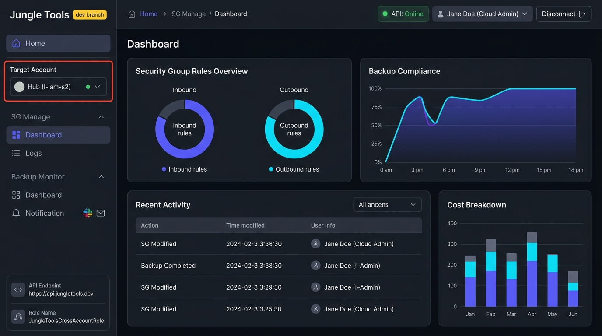
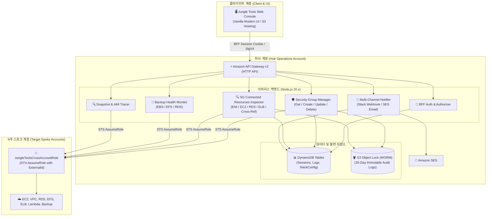

# Jungle Tools Console (AWS Multi-Account Operations & Backup Monitor)

<p align="center">
  
</p>

<p align="center">
  <strong>외부 SaaS 의존 없는 100% 자체 호스팅(Self-Hosted) 멀티 어카운트 클라우드 거버넌스 & 백업 관제 콘솔</strong><br/>
  VPC 보안 그룹 통합 제어 및 연관 리소스 심층 인스펙션 | EBS·EFS·RDS 백업 헬스 관제 | WORM S3 Object Lock 감사 로깅 | Slack·Email 지능형 알림
</p>

---

## 📖 프로젝트 소개 (Project Introduction)

**Jungle Tools Console**은 사용자의 AWS 인프라 환경에 직접 배포하여 사용하는 **셀프 호스티드(Self-Hosted) 클라우드 인프라 운영 솔루션**입니다.

기업의 멀티 계정(Hub-Spoke 구조) AWS 환경에서 외부 서드파티 SaaS 도구에 민감한 자격 증명이나 인프라 데이터를 위탁할 필요 없이, **사용자 소유의 AWS 계정 내에서 VPC 보안 그룹(Security Group) 라이프사이클 관리**, **실환경 연관 리소스(EC2, RDS, ELB, Lambda 등) 심층 역추적**, **멀티 서비스 백업(EBS, EFS, RDS) 실시간 헬스케어**, **고아 스냅샷 및 미사용 AMI 비용 최적화**, 그리고 **다채널 알림(Slack & Email) 자동화**를 완벽하게 통제할 수 있습니다.

### 💡 왜 Jungle Tools인가? (Why Jungle Tools?)
- **100% In-Account Security**: 데이터와 자격 증명이 외부 서버를 경유하지 않으며 사용자 소유의 AWS 리소스에만 안전하게 보관됩니다.
- **Serverless Zero Idle Cost**: EC2나 상시 컨테이너가 전혀 없으며, S3 웹 호스팅, API Gateway, Lambda, DynamoDB On-Demand로 구성되어 유휴 운영 비용이 거의 발생하지 않습니다.
- **WORM Compliance Audit Trail**: 모든 방화벽 변경 사항이 30일간 변조 및 삭제가 불가능한 S3 Object Lock(WORM) 스토리지에 자동 보존되어 금융/엔터프라이즈 보안 감사를 완벽 준수합니다.
- **Seamless Multi-Account Operations**: 표준 IAM STS AssumeRole 기반으로 허브 계정 1개와 스포크 계정 9개(총 10개 계정)를 웹 콘솔에서 원클릭으로 전환하며 통합 관리합니다.

---

## 🌟 핵심 기능 요약 (Key Features Summary)

### 1. 🛡️ VPC 보안 그룹 통합 관리 & 연관 리소스 심층 인스펙션 (SG Manage)
* **VPC별 보안 그룹 실시간 탐색 & 생성/삭제**:
  * 멀티 VPC 환경의 모든 보안 그룹을 가로 탭과 다차원 키워드 검색(이름, ID, 설명, CIDR)으로 신속하게 탐색.
  * 신규 보안 그룹 생성 및 안전 삭제 지원.
* **비주얼 방화벽 룰 편집기 (Inbound / Outbound Editor)**:
  * 프로토콜(All traffic, TCP, UDP, ICMP), 포트 범위(From~To), 소스/목적지(CIDR, 타 SG 참조)를 GUI 화면에서 손쉽게 추가, 수정, 삭제.
  * 포트 유효 범위(0~65535) 및 CIDR 엄격한 사전 클라이언트 유효성 검증.
* **[신규] 연관 리소스(Connected Resources) 실시간 역추적**:
  * 보안 그룹에 연결된 모든 **EC2 인스턴스, ALB, NLB, GWLB, RDS 인스턴스/오로라 클러스터, Lambda VPC 인터페이스, VPC Endpoint(PrivateLink), NAT Gateway, ENI**를 실시간 역추적하여 목록화.
  * **타 보안 그룹 교차 참조(Cross-SG Reference) 감지**: 다른 보안 그룹의 방화벽 규칙에서 본 보안 그룹을 참조하고 있는지 자동 검사하여 연결 단절 사고를 미연에 방지.
  * **고아(Orphaned) 보안 그룹 자동 판별**: 연결된 리소스와 참조 룰이 없는 경우 `Unused (Safe to Delete)` 뱃지 및 안전 삭제 권고 안내 제공.
  * **터미널 실행 로그 & 지능형 진단 팁**: API 호출 진행 과정을 모노스페이스 터미널 로그로 실시간 스트리밍하고, Spoke 계정 IAM 권한 누락 시 구체적인 해결 팁 제시.

---

### 2. 💾 멀티 서비스 백업 상태 관제 (Backup Monitor)
* **EBS 볼륨 & 스냅샷 헬스케어**:
  * EBS 볼륨 상태 및 최신 스냅샷 생성 일시, 진행 상태를 실시간 매핑.
* **EFS 파일 시스템 자동 백업 점검**:
  * EFS 파일 시스템 상태 및 AWS Backup 자동 보호 정책(`ENABLED` / `DISABLED`) 점검.
* **RDS & Aurora DB 클러스터 백업 진단**:
  * RDS 인스턴스/오로라 클러스터 스냅샷 상태 및 최신 복원 시점(PITR, `LatestRestorableTime`) 진단.
* **3단계 헬스 평가 알고리즘**:
  * 🟢 **Healthy (정상)**: 최근 7일 이내 성공 백업 완료.
  * 🔴 **Failure (위험/경고)**: 백업 오류 발생 또는 최근 백업이 8일 이상 경과.
  * 🟡 **Unprotected (미보호)**: 백업 정책이나 스냅샷이 전혀 존재하지 않는 무방비 자원.

---

### 3. 🔍 고아 스냅샷 및 비정상 AMI 비용 최적화 추적기 (Cost Optimization)
* **Snapshot Tracer**:
  * 원본 볼륨이 이미 삭제되었으나 남아있는 고아(Orphaned) EBS 스냅샷을 식별하여 불필요한 스토리지 요금 누수 차단.
* **AMI Tracer**:
  * 가동 중인 EC2 인스턴스나 Launch Template에서 전혀 참조되지 않는 미사용 노후 AMI를 탐색하고, Deregister 시 매월 절감 가능한 예상 스토리지 비용(`-$xx.xx/월`)을 실시간 시뮬레이션.

---

### 4. 🔒 WORM S3 Object Lock & DynamoDB 통합 감사 추적 (Audit Trail)
* **법적 효력을 갖는 불변 감사 로깅**:
  * 보안 그룹 생성, 규칙 변경, 삭제 등 모든 인프라 제어 이력을 DynamoDB(`SgAuditLogs`)와 S3 WORM 스토리지에 동시 기록.
* **S3 Object Lock (30일 보존)**:
  * 루트 계정을 포함한 그 누구도 보존 기간 내에 로그를 삭제하거나 변조할 수 없는 `GOVERNANCE` 모드 적용.
* **JSON Diff 뷰어**:
  * 각 변경 건의 작업자(IAM Principal), 일시, 변경 전/후 규칙 Diff 및 S3 원본 객체 URI를 모달 창에서 상세 열람.

---

### 5. 🔔 다채널 지능형 알림 자동화 (Notification Center)
* **Slack Incoming Webhook**:
  * 복수의 운영 채널 웹훅 등록, 4가지 메시지 포맷(`summary`, `report`, `preview`, `full`), EventBridge 크론 스케줄 자동 발송 및 즉시 테스트 지원.
* **Slack Channel Email (AWS SES)**:
  * 슬랙 채널 고유 이메일(`channel@workspace.slack.com`)로 종합 표 형식 HTML 백업 보고서 자동 전송.
* **사내 / AWS SES SMTP 연동**:
  * SMTP 호스트, 포트(587/465/25), STARTTLS/SSL 연동 및 실시간 250 OK 연결 진단.
* **수신자 디렉토리 관리**:
  * 인프라/DBA/개발팀 담당자별 이메일 주소록 등록, 활성/일시정지 토글, 일괄 모의 보고서 발송 지원.

---

### 6. 🏢 멀티 어카운트 원클릭 AssumeRole 스위칭
* **10개 AWS 계정 기본 연동**:
  * Hub 계정(운영자 계정) 1개 + Spoke 계정 9개(`dev`, `test`, `prd`, `cicd`, `logging`, `bi` 등) 지원.
* **BFF 기반 세션 보안**:
  * AWS STS 임시 자격 증명 검증 후 `HttpOnly; Secure; SameSite=None` 8시간 보안 쿠키 발급.
  * 크로스 어카운트 호출 시 안전한 `JungleToolsCrossAccountRole` 및 ExternalId 자동 주입.

---

### 🖥️ 주요 콘솔 화면 미리보기 (Live Console Preview)

| 화면 | 설명 | 실제 브라우저 캡처 |
| :--- | :--- | :---: |
| **통합 오퍼레이션 대시보드** | 전체 계정 인프라 요약 및 퀵 배너 | [대시보드 보기](docs/images/screen_home.jpg) |
| **보안 그룹 및 방화벽 관리** | VPC별 보안 그룹 목록 및 인/아웃바운드 규칙 편집 | [SG 관리 보기](docs/images/screen_sg_dashboard.jpg) |
| **방화벽 규칙 편집기** | 인바운드/아웃바운드 실시간 규칙 추가, 수정, 즉시 적용 | [규칙 편집기 보기](docs/images/screen_sg_detail.jpg) |
| **연관 리소스 심층 분석** | EC2, ELB, RDS, Lambda 등 ENI 역추적 및 타 SG 교차 참조 | [연관 리소스 보기](docs/images/screen_sg_resources.jpg) |
| **멀티 서비스 백업 관제** | EBS 스냅샷, EFS 파일시스템, RDS 백업 상태 실시간 감시 | [백업 관제 보기](docs/images/screen_backup.jpg) |
| **EBS 스냅샷 및 AMI 추적기** | 고아 스냅샷 및 미사용 AMI 탐색, 절감 비용 계산 | [스냅샷 추적기](docs/images/screen_backup_snapshot_tracer.jpg) / [AMI 추적기](docs/images/screen_backup_ami_tracer.jpg) |
| **WORM 보안 감사 로그** | S3 Object Lock 30일 불변 감사 기록 조회 | [감사 로그 보기](docs/images/screen_sg_logs.jpg) |
| **Slack & Email 알림** | 다중 Slack Webhook 등록 및 Email SMTP/주소록 | [Slack 웹훅](docs/images/screen_slack_webhook.jpg) / [이메일 주소록](docs/images/screen_email.jpg) |

---

## 🏗️ 시스템 아키텍처 (System Architecture)



---

## 📚 공식 기술 문서 및 매뉴얼 (`docs/`)

| 문서명 | 주요 내용 | 링크 |
| :--- | :--- | :---: |
| **서비스 소개서** | 제품 포지셔닝, 4대 가치, 셀프 호스티드 도입 효과 및 ROI | [SERVICE_INTRODUCTION.md](docs/SERVICE_INTRODUCTION.md) |
| **종합 사용자 매뉴얼** | 공통 UI, 화면별 상세 기능, **연관 리소스 사용법**, 운영 FAQ | [USER_MANUAL.md](docs/USER_MANUAL.md) |
| **종합 기능 맵** | 마인드맵, 전체 메뉴 계층 구조, 백엔드 API 매핑 명세표 | [FEATURE_MAP.md](docs/FEATURE_MAP.md) |
| **설치 및 배포 가이드** | AWS SAM CLI 빌드, Spoke 계정 IAM 역할 배포, 환경 설정 | [INSTALL.md](docs/INSTALL.md) |
| **테스트 시나리오 명세서** | 프론트엔드 JSDOM(8개), 단위 테스트(21개), 실환경 E2E(16개) | [TEST_SCENARIOS.md](docs/TEST_SCENARIOS.md) |
| **English Overview** | English project overview, key features, and architecture | [README_EN.md](README_EN.md) |

---

## 🚀 빠른 시작 (Quick Start)

### 사전 요구 사항
- **Node.js**: v20.x 이상
- **AWS CLI**: v2.x 이상 (적절한 IAM 관리자 권한 구성)
- **AWS SAM CLI**: v1.100.0 이상

### 1) 백엔드 및 인프라 배포 (Hub 계정)
```bash
# 1. 의존성 설치
npm install --prefix backend

# 2. SAM 빌드 및 배포
sam build
sam deploy --guided
```

### 2) 스포크(Spoke) 계정 교차 권한 배포 (9개 계정)
```bash
# 단일 스포크 계정 배포
aws cloudformation deploy \
  --template-file spoke-account-template.yaml \
  --stack-name JungleToolsCrossAccountRole \
  --parameter-overrides HubAccountId=<HUB_ACCOUNT_ID> \
  --capabilities CAPABILITY_NAMED_IAM

# 또는 일괄 자동 배포 스크립트 실행
./scripts/setup-all-spokes.sh
```

### 3) 프론트엔드 S3 동기화
```bash
# frontend/config.js 내 API Gateway URL 확인 후 S3 버킷 동기화
aws s3 sync frontend/ s3://<FRONTEND_BUCKET_NAME>/ --delete
```

### 4) 자동화 테스트 실행 (단위 + E2E)
```bash
# 백엔드 단위 및 UI 테스트
npm test --prefix backend

# 실환경 클라우드 E2E 통합 테스트
./scripts/test-all.sh
```

---

## 📄 라이선스 (License)

This project is licensed under the Apache License 2.0 - see the [LICENSE](LICENSE) file for details.
