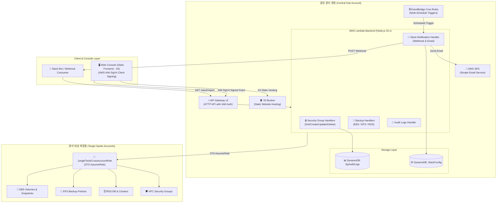

# Jungle Tools Console (AWS Multi-Account Operations & Backup Monitor)

사용자가 자체 AWS 계정에 직접 배포하여 사용하는 **셀프 호스티드(Self-Hosted) 클라우드 인프라 거버넌스 및 백업 관제 솔루션**입니다.  
외부 SaaS에 자격 증명을 위탁하지 않고, 단일 계정 및 멀티 계정(Hub-Spoke 구조) 환경에서 **EC2 보안 그룹(VPC Security Group)**의 통합 제어 및 **EBS / EFS / RDS 백업 상태**를 실시간 관제하며, **Slack 웹훅(Webhook)** 및 **AWS SES / SMTP 기반 이메일**로 맞춤형 일일 보고서를 자동 발송합니다.

---

## 📚 공식 매뉴얼 및 기술 문서 (`docs/`)

- **[📄 서비스 소개서 (Service Overview)](docs/SERVICE_INTRODUCTION.md)**: 셀프 호스티드 솔루션 개요 및 도입 효과
- **[📖 종합 사용자 매뉴얼 (User Manual)](docs/USER_MANUAL.md)**: 메뉴별 상세 기능 및 모든 화면 UI 요소 완벽 해설
- **[🗺️ 종합 기능 맵 (Feature Map)](docs/FEATURE_MAP.md)**: 화면 계층 구조 및 백엔드 API 매핑 명세
- **[🚀 설치 및 배포 가이드 (Installation Guide)](docs/INSTALL.md)**: CloudFormation & SAM 기반 배포
- **[🧪 전체 기능 테스트 시나리오 명세서 (Test Scenarios)](docs/TEST_SCENARIOS.md)**: 프론트엔드 UI/단위/E2E 33종 자동화 테스트
- **[🌐 English Overview](docs/README_EN.md)**: English project overview & architecture

---

## 🌟 주요 기능 (Key Features)

### 1. 🏠 최상단 `Home` 통합 대시보드 (Unified Operations Dashboard)
* **초기 랜딩 관제 페이지**: 애플리케이션 접속 시 첫 화면으로 전체 인프라 상태를 한눈에 조망.
* **SG Manage 관제 패널**: Active VPCs, Total Security Groups, Inbound Rules 실시간 집계 및 바로가기.
* **Backup Monitor 관제 패널**: Total Resources, Healthy (<=7d), Failure/Warning, Unprotected 지표 실시간 집계 및 바로가기.
* **비동기 병렬 동기화**: `Promise.allSettled` 기반 백그라운드 병렬 호출로 페이지 로딩 속도 최적화.
* **빠른 탐색 (Quick Access) 배너**: 알림 설정(Slack/Email) 및 보안 감사 로그 화면으로 원클릭 이동 지원.

---

### 2. 🛡️ VPC 보안 그룹 통합 관리 (SG Manage)
* **멀티 계정 보안 그룹 관리 (`SG Manage > Dashboard`)**:
  * 중앙 관리 계정 및 등록된 Spoke 계정들의 VPC별 보안 그룹 목록 실시간 조회 및 검색.
  * 신규 보안 그룹 생성, 불필요한 보안 그룹 안전 삭제.
  * 인바운드 / 아웃바운드 방화벽 규칙(CIDR, Security Group ID, Port, Protocol) 실시간 추가 및 삭제.
* **보안 변경 감사 로그 (`SG Manage > Logs`)**:
  * 보안 그룹 생성, 삭제, 룰 변경 이력을 DynamoDB(`SgAuditLogsTable`)에 불변 기록하여 변경 내역 추적 및 감사 준수.

---

### 3. 💾 멀티 서비스 백업 모니터링 (Backup Monitor)
* **종합 백업 관제판 (`Backup Monitor > Dashboard`)**:
  * **EBS 볼륨 & 스냅샷**: 볼륨 상태, 최신 스냅샷 생성 결과 및 경과일 기준 백업 상태(Healthy, Failure, Unprotected) 판별.
  * **EFS 파일 시스템**: EFS 파일 시스템 상태 및 자동 백업 정책(ENABLED / DISABLED) 실시간 점검.
  * **RDS DB 인스턴스 & 클러스터**: DB 인스턴스 상태, 수동/자동 스냅샷, Aurora 최신 복구 시점(`LatestRestorableTime`) 진단.
  * **헬스 상태 판별 기준**:
    * `Healthy` (정상): 최근 7일 이내 성공적인 백업/스냅샷 존재
    * `Failure` (실패/경고): 백업 오류 또는 8일 이상 경과된 오래된 백업
    * `Unprotected` (미보호): 백업 정책 또는 스냅샷이 전혀 없는 리소스

---

### 4. 🔔 멀티 채널 알림 관리 (Notification Center)
* **Slack 알림 (`Backup Monitor > Notification > Slack`)**:
  1. **🔗 웹훅 (Incoming Webhook)**:
     * **다중 웹훅 지원**: N개의 슬랙 웹훅 URL 및 개별 크론 스케줄 관리.
     * **4가지 전송 메시지 타입**:
       * `summary`: 간결한 전체 요약 및 헬스 백분율 지표.
       * `report`: 리소스 종류별(EBS/EFS/RDS) 상세 마크다운 보고서.
       * `preview`: 즉각 조치가 필요한 Failure/Warning 리소스 상위 5건 집중 표시.
       * `full`: 등록된 모든 AWS 대상 계정 전체의 백업 현황을 계정 프로파일별로 리스팅.
  2. **✉️ Email (Slack Channel Email)**:
     * 슬랙 채널 고유 이메일 주소 연동 및 SES 기반 표 형식(HTML) 일일 보고서 전송.
* **Email 알림 (`Backup Monitor > Notification > Email`)**:
  1. **⚙️ SMTP 설정**:
     * AWS SES 또는 사내 메일 서버(SMTP Host, Port 587/465/25, 암호화 STARTTLS/SSL/TLS, 계정 인증) 설정.
     * 실시간 SMTP 핸드셰이크 연결 테스트 지원.
  2. **👥 주소 등록**:
     * 백업 보고서를 수신할 담당자 이메일 주소록 관리 (등록, 수정, 삭제).
     * 수신자별 활성/일시정지 토글 및 활성 수신자 대상 즉시 테스트 발송 지원.

---

### 5. 🔒 엔터프라이즈 제로 트러스트 보안 (Security Architecture)
* **100% In-Account 자체 구동**: 외부 서버로 자격 증명이나 인프라 데이터가 일절 유출되지 않음.
* **브라우저 클라이언트 사이드 AWS SigV4 서명**: 웹 브라우저에서 직접 HMAC-SHA256 암호화 서명 후 자체 API Gateway로 통신.
* **IAM 최소 권한 원칙 (Least Privilege)**: 계정 간 호출 시 15분 임시 자격 증명의 STS AssumeRole(`JungleToolsCrossAccountRole`) 사용.
* **Slack Webhook SSRF 방지**: `https://hooks.slack.com/` 대상 엄격한 도메인 및 경로 화이트리스트 검증.
* **DynamoDB SSE 암호화**: 저장 데이터(Rest Encryption)를 위한 AWS KMS / SSE 활성화.

---

## 🏗️ 시스템 아키텍처 (System Architecture)



---

## 📁 프로젝트 파일 구조 (Project Structure)

```text
jungletools/
├── env.json                          # 🔒 local 환경변수 (자동 생성 / Git 제외)
├── env.example.json                  # ⚙️ 환경변수 샘플 템플릿
├── template.yaml                     # 중앙 Hub 계정 SAM / CloudFormation 템플릿
├── spoke-account-template.yaml       # Spoke 대상 계정 Cross-Account IAM Role 템플릿
├── backend/                          # AWS Lambda 서버리스 백엔드
│   ├── utils.mjs                     # 공통 SigV4, CORS, STS AssumeRole, DynamoDB 헬퍼
│   ├── getSecurityGroups/            # 보안 그룹 및 VPC 목록 조회
│   ├── createSecurityGroup/          # 보안 그룹 생성
│   ├── deleteSecurityGroup/          # 보안 그룹 삭제
│   ├── updateSecurityGroupRules/     # 인바운드/아웃바운드 규칙 일괄 수정
│   ├── getAuditLogs/                 # 보안 그룹 변경 감사 로그 조회
│   ├── getEbsSnapshots/              # EBS 볼륨 & 최신 스냅샷 상태 조회
│   ├── getEfsBackups/                # EFS 파일시스템 & 백업 정책 조회
│   ├── getRdsBackups/                # RDS 인스턴스/클러스터 & 스냅샷 조회
│   ├── getSlackConfig/               # Slack/Email 알림 설정 조회
│   ├── saveSlackConfig/              # Slack/Email 알림 설정 저장
│   └── sendSlackNotification/        # Slack Webhook (4개 메시지 타입) & Email 리포트 발송
├── frontend/                         # 정적 웹 콘솔 (Vanilla JS & Modern Dark CSS)
│   ├── config.js                     # 🔒 프론트엔드 API 엔드포인트 설정 (자동 생성)
│   ├── config.example.js             # 프론트엔드 설정 템플릿
│   ├── sigv4.js                      # CryptoJS 기반 브라우저 SigV4 암호화 서명 엔진
│   ├── app.js                        # 대시보드 라우터, UI 이벤트, API 연동 로직
│   ├── index.html                    # Home, SG Manage, Backup Monitor, Notification UI
│   └── styles.css                    # 모던 다크 테마 및 반응형 디자인 시스템
├── docs/                             # 📚 프로젝트 공식 문서 디렉토리
│   ├── README.md                     # 기술 문서 인덱스 및 목차
│   ├── SERVICE_INTRODUCTION.md       # 서비스 소개서 (셀프 호스티드 솔루션 개요)
│   ├── USER_MANUAL.md                # 종합 사용자 매뉴얼
│   ├── FEATURE_MAP.md                # 종합 기능 맵 (화면 계층 & API 매핑)
│   ├── INSTALL.md                    # 설치 및 환경 구성 가이드
│   ├── TEST_SCENARIOS.md             # 전체 기능 테스트 시나리오 명세서
│   ├── README_EN.md                  # Project Documentation (English)
│   ├── index.html / manual.html      # 웹 매뉴얼 에셋
│   └── images/                       # 문서 이미지
├── scripts/                          # 배포 및 설정 자동화 스크립트
│   ├── deploy-all.sh / .ps1          # 백엔드 SAM 빌드/배포 + 프론트엔드 S3 동기화
│   ├── generate-env-json.sh / .ps1   # AWS CLI 프로파일 기반 env.json 생성
│   ├── generate-frontend-config.ps1  # 프론트엔드 config.js 자동 생성
│   ├── setup-all-profiles.ps1        # AWS 프로파일 초기화
│   ├── setup-all-spokes.sh           # 관리 대상 Spoke 계정 IAM Role 일괄 배포
│   └── setup-spoke-account.sh / .ps1 # 단일 Spoke 계정 IAM Role 배포
└── README.md                         # 프로젝트 메인 안내 문서 (한국어)
```

---

## 🚀 빠른 시작 및 배포 가이드 (Quick Start & Deployment)

자세한 설치 단계 및 환경 변수 구성은 **[docs/INSTALL.md](docs/INSTALL.md)**를 참조하세요.

### 1. 사전 준비 (Prerequisites)
* **Node.js (v20.x 이상)** & **npm**
* **AWS CLI (v2.x 이상)**: `~/.aws/credentials`에 배포 권한이 있는 프로필 등록
* **AWS SAM CLI (v1.100 이상)**: 백엔드 빌드 및 배포용

### 2. Spoke 계정 Cross-Account Role 배포 (멀티 계정 구성 시)
관리 대상이 되는 Spoke 계정에 중앙 Hub 계정을 신뢰하는 IAM 역할을 배포합니다:
```bash
# Linux / macOS
chmod +x ./scripts/setup-all-spokes.sh
./scripts/setup-all-spokes.sh

# Windows (PowerShell)
.\scripts\setup-spoke-account.ps1 -ProfileName <SPOKE_PROFILE> -HubAccountId <HUB_ACCOUNT_ID>
```

### 3. 전체 인프라 원클릭 배포 (`deploy-all.sh`)
중앙 관리 계정에 백엔드 SAM 스택과 프론트엔드 정적 웹사이트를 한 번에 빌드 및 배포합니다:
```bash
# Linux / macOS
chmod +x ./scripts/deploy-all.sh
./scripts/deploy-all.sh <HUB_PROFILE> <REGION>

# Windows (PowerShell)
.\scripts\deploy-all.ps1 -HubProfile <HUB_PROFILE> -Region <REGION>
```

> **배포 완료 시 출력되는 정보:**
> * **CloudFormation Stack**: `jungle-tools-stack`
> * **API Gateway Endpoint**: `https://<API_ID>.execute-api.<REGION>.amazonaws.com`
> * **Frontend Website URL**: `http://<BUCKET_NAME>.s3-website.<REGION>.amazonaws.com`

---

## 🖥️ 로컬 개발 및 테스트 (Local Development)

백엔드 배포 없이 프론트엔드 UI/UX만을 단독으로 로컬에서 테스트할 수 있습니다:

```bash
# 로컬 웹 서버 구동 (포트 3000)
python3 -m http.server 3000 --directory frontend
```

브라우저에서 **[http://localhost:3000](http://localhost:3000)** 접속 후:
* 로그인 팝업 우측 상단의 `×` 버튼을 누르면 자격 증명 없이도 **Home**, **SG Manage**, **Backup Monitor**, **Notification (Slack / Email)**의 모든 메뉴 전환과 UI 동작을 자유롭게 점검할 수 있습니다.

---

## 📄 라이선스 (License)

본 프로젝트는 Apache 2.0 라이선스를 따릅니다.
