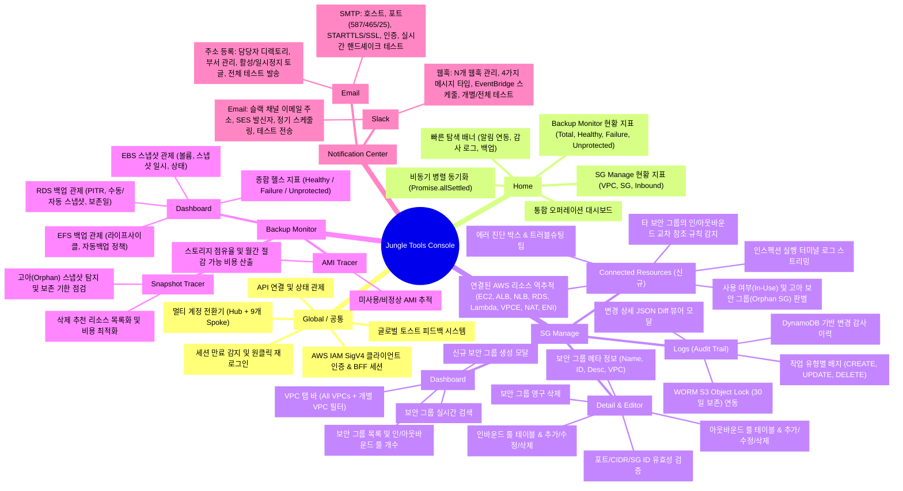
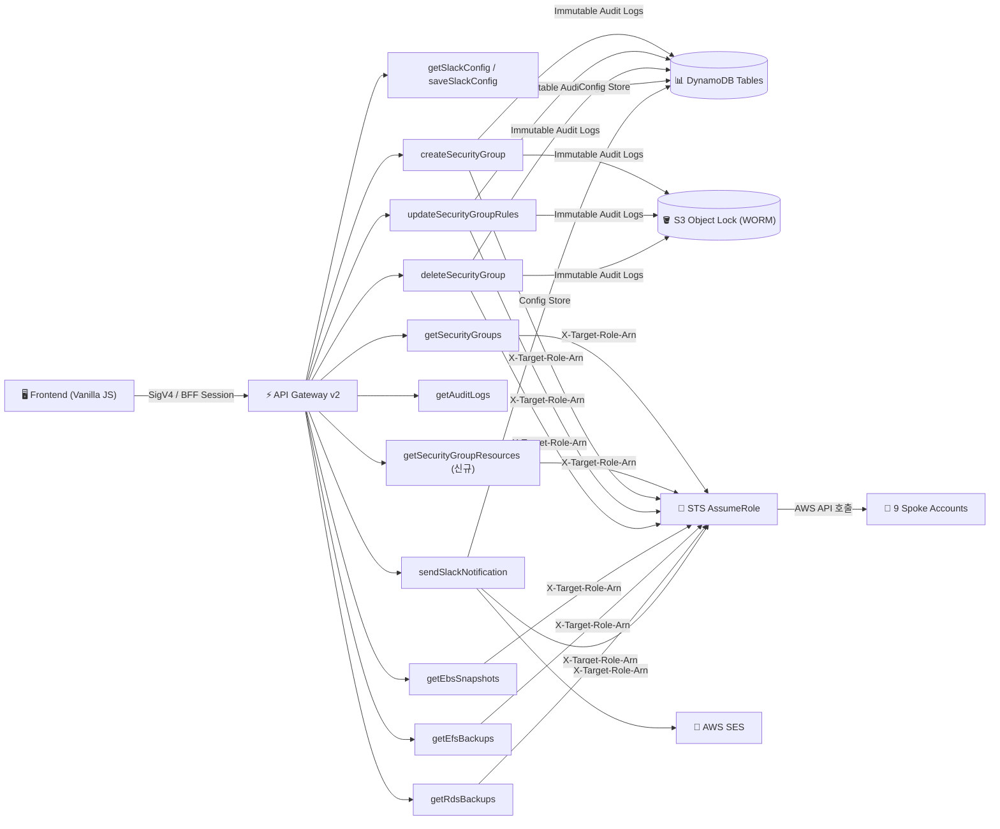

# Jungle Tools Console 종합 기능 맵 (Feature Map)

**Jungle Tools Console**은 다중 AWS 계정(Hub 계정 1개 + Spoke 계정 9개, 총 10개 계정) 환경에서 **VPC 보안 그룹(Security Group) 통합 제어 및 연관 리소스 심층 인스펙션**, **멀티 서비스 백업 상태(EBS / EFS / RDS) 모니터링**, **고아 스냅샷 및 비정상 AMI 추적(비용 최적화)**, **WORM S3 Object Lock 컴플라이언스 감사 추적**, 그리고 **다채널 지능형 알림(Slack Webhook, Slack Email, 사내/SES SMTP, 수신자 디렉토리)**을 전담하는 엔터프라이즈급 클라우드 네이티브 서버리스 운영 솔루션입니다.

본 문서는 프론트엔드 UI/UX 메뉴 계층 구조, 세부 기능, 백엔드 서버리스 API 매핑 및 멀티 계정 보안 통신 아키텍처를 총망라한 **기능 맵(Feature Map)**입니다.

---

## 1. 전체 기능 맵 계층 다이어그램 (Mindmap & Hierarchy)

---

## 2. 메뉴별 상세 기능 맵 (Depth 1 ~ Depth 3)

### 📌 0. 글로벌 탑바 & 인증/공통 시스템 (Global & Infrastructure)

| 기능 분류 (L2) | 세부 기능 (L3) | 상세 내용 및 사용자 인터랙션 | 연동 파일 / API |
| :--- | :--- | :--- | :--- |
| **API 연결 관리** | • API Endpoint 설정 | • API Gateway 기본 URL 설정 및 `localStorage` 영구 보관 • 엔드포인트 수동 입력 및 `Set` 버튼 연동 | [frontend/app.js](file:///c:/project/jungletools/frontend/app.js) |
| | • 연결 상태 인디케이터 | • `Online` (정상 통신), `Connecting...` (요청 중), `Disconnected` (미연결), `Session Expired` (만료) 상태 시각화 | [frontend/app.js](file:///c:/project/jungletools/frontend/app.js) |
| **멀티 계정 전환** | • 타겟 계정 셀렉터 | • Hub 계정 및 9개 Spoke 계정 드롭다운 즉시 선택 • 계정 선택 시 `localStorage` 자동 동기화 및 전역 리프레시 | [frontend/index.html](file:///c:/project/jungletools/frontend/index.html) [frontend/config.js](file:///c:/project/jungletools/frontend/config.js) |
| | • Cross-Account Role 지정 | • STS AssumeRole 대상 역할명(`JungleToolsCrossAccountRole`) 지정 • API 호출 시 `X-Target-Role-Arn` 헤더 자동 주입 | [frontend/app.js](file:///c:/project/jungletools/frontend/app.js) [backend/utils.mjs](file:///c:/project/jungletools/backend/utils.mjs) |
| **보안 인증 (IAM SigV4)** | • IAM 로그인 오버레이 | • Access Key, Secret Access Key, Session Token(MFA), Region 입력 • STS 임시 자격 증명 발급용 CLI 가이드 제공 | [frontend/index.html](file:///c:/project/jungletools/frontend/index.html) |
| | • 클라이언트 서명 (SigV4) | • CryptoJS 기반 브라우저 로컬 HMAC-SHA256 서명 • 제3자 서버 경유 없이 AWS API Gateway로 직접 전송 | [frontend/sigv4.js](file:///c:/project/jungletools/frontend/sigv4.js) |
| | • 세션 만료 감지 & 원클릭 복구 | • 401/403 응답 감지 시 만료 모달 및 토스트 즉각 노출 • 기존 설정값 유지한 채 새 키 입력 재로그인 지원 | [frontend/app.js](file:///c:/project/jungletools/frontend/app.js) |
| | • 세션 로그아웃 | • 로컬 자격 증명 즉시 파기 및 UI 초기화 (`Disconnect`) | [frontend/app.js](file:///c:/project/jungletools/frontend/app.js) |
| **UI 피드백 시스템** | • 브레드크럼(Breadcrumb) | • 현재 위치 동적 렌더링 (예: `SG Manage / Dashboard`, `Backup Monitor / Notification / Slack / 웹훅`) | [frontend/app.js](file:///c:/project/jungletools/frontend/app.js) |
| | • 글로벌 토스트 알림 | • 성공(`success`), 실패(`error`), 경고(`warning`), 정보(`info`) 알림 • 알림 내 재로그인 등 인라인 액션 버튼 지원 | [frontend/app.js](file:///c:/project/jungletools/frontend/app.js) |

---

### 🏠 1. Home (통합 오퍼레이션 대시보드)

* **진입 경로**: 사이드바 최상단 `Home` (`#nav-home` ➔ `#view-home`)
* **목적**: 접속 시 인프라 방화벽(SG)과 백업 헬스 상태 전체를 단일 화면에서 요약 관제하고 필요 화면으로 빠르게 분기.

| 영역 (L2) | 세부 기능 (L3) | 인터랙션 및 처리 로직 | 연동 백엔드 |
| :--- | :--- | :--- | :--- |
| **헤더 & 제어** | • 전체 지표 즉시 새로고침 | • `Promise.allSettled`를 통해 SG 현황과 백업 현황을 백그라운드 병렬 호출하여 UI 블로킹 없이 동기화 | `GET /security-groups` `GET /backups/ebs, efs, rds` |
| **SG Manage 관제 패널** | • Active VPCs 지표 | • 현재 계정/리전의 활성 VPC 개수 실시간 표시 | `GET /security-groups` |
| | • Total Security Groups 지표 | • 전체 보안 그룹 개수 합산 표시 | |
| | • Inbound Rules 지표 | • 인바운드 방화벽 규칙 총합 실시간 카운트 | |
| | • 바로가기 액션 | • `보안 그룹 관리 바로가기` 클릭 시 `SG Manage > Dashboard`로 즉시 전환 | [frontend/app.js](file:///c:/project/jungletools/frontend/app.js) |
| **Backup Monitor 관제 패널** | • Total Resources 지표 | • EBS 볼륨 + EFS 파일시스템 + RDS DB 인스턴스 전체 자원 합산 | `GET /backups/ebs` `GET /backups/efs` `GET /backups/rds` |
| | • Healthy 지표 (<=7d) | • 7일 이내 정상 스냅샷/백업이 완료된 정상 리소스 수 | |
| | • Failure 지표 (Error/>=8d) | • 백업 실패 또는 8일 이상 경과되어 즉각 조치가 필요한 위험 리소스 수 | |
| | • Unprotected 지표 | • 백업 정책이나 스냅샷이 전혀 없는 무방비 리소스 수 | |
| | • 바로가기 액션 | • `백업 현황 상세 바로가기` 클릭 시 `Backup Monitor > Dashboard` 전환 | [frontend/app.js](file:///c:/project/jungletools/frontend/app.js) |
| **빠른 탐색 카드 (Quick Access)** | • 알림 연동 바로가기 | • `Slack 웹훅 설정` 또는 `이메일 주소록` 메뉴로 원클릭 이동 | [frontend/index.html](file:///c:/project/jungletools/frontend/index.html) |
| | • 보안 변경 감사 로그 바로가기 | • `감사 로그 확인` 클릭 시 WORM/DynamoDB 감사 로그 뷰어로 이동 | [frontend/index.html](file:///c:/project/jungletools/frontend/index.html) |

---

### 🛡️ 2. SG Manage (VPC 보안 그룹 통합 제어 및 연관 리소스 인스펙션)

#### 2.1 SG Manage > Dashboard (`#view-sg-dashboard`)
* **목적**: 멀티 VPC 환경의 보안 그룹들을 시각화하고 검색, 탐색, 생성하는 메인 워크스페이스.

| 기능 분류 (L2) | 세부 기능 (L3) | 상세 스펙 | 연동 소스 / API |
| :--- | :--- | :--- | :--- |
| **요약 메트릭** | • 3대 핵심 KPI | • `Active VPCs`, `Total Security Groups`, `Inbound Rules` 실시간 표시 | [frontend/app.js](file:///c:/project/jungletools/frontend/app.js) |
| **VPC 탭 네비게이션** | • All VPCs 탭 | • 전체 VPC의 보안 그룹을 통합 집계하여 표시 (총 개수 배지 제공) | [frontend/app.js](file:///c:/project/jungletools/frontend/app.js) |
| | • 개별 VPC 탭 바 | • 감지된 VPC별 가로 탭 동적 생성 (VPC 이름, ID, CIDR 블록, 소속 SG 개수 툴팁) | [frontend/app.js](file:///c:/project/jungletools/frontend/app.js) |
| **실시간 검색 필터** | • 다차원 키워드 필터링 | • 보안 그룹명, Group ID(`sg-xxxx`), 설명, VPC ID, VPC명 실시간 다중 매칭 • 검색어 원클릭 초기화(`X`) 버튼 지원 | [frontend/app.js](file:///c:/project/jungletools/frontend/app.js) |
| **보안 그룹 목록 테이블** | • 컬럼 구성 | • Name, Group ID, VPC ID / Name, Description, Rules (In/Out 개수 배지), Actions | [frontend/index.html](file:///c:/project/jungletools/frontend/index.html) |
| | • 상세 진입 액션 | • 행 클릭 또는 `Manage` 버튼 클릭 시 상세 규칙 편집 뷰(`view-sg-detail`)로 진입 | [frontend/app.js](file:///c:/project/jungletools/frontend/app.js) |
| **신규 보안 그룹 생성** | • 모달 팝업 트리거 | • `New Security Group` 클릭 시 모달 호출 (`#modal-create-sg`) | [frontend/app.js](file:///c:/project/jungletools/frontend/app.js) |
| | • SG 파라미터 입력 | • SG Name, Description, VPC 셀렉트박스, Name 태그 입력 | [frontend/index.html](file:///c:/project/jungletools/frontend/index.html) |
| | • 백엔드 처리 & 감사 기록 | • `ec2:CreateSecurityGroup`, `ec2:CreateTags` 실행 후 DynamoDB `SgAuditLogs` 및 WORM S3에 불변 기록 | `POST /security-groups` [backend/createSecurityGroup/app.mjs](file:///c:/project/jungletools/backend/createSecurityGroup/app.mjs) |

#### 2.2 SG Manage > Detail & Editor (`#view-sg-detail`)
* **목적**: 특정 보안 그룹의 인바운드/아웃바운드 방화벽 규칙을 추가/수정/삭제하고, **연결된 AWS 리소스(EC2, RDS, ELB 등) 및 타 SG 참조 현황을 실시간 심층 분석**.

| 기능 분류 (L2) | 세부 기능 (L3) | 상세 스펙 | 연동 소스 / API |
| :--- | :--- | :--- | :--- |
| **헤더 & 메타 정보** | • SG 식별 정보 | • 보안 그룹명, 그룹 ID, Description, 소속 VPC ID 표시 | [frontend/index.html](file:///c:/project/jungletools/frontend/index.html) |
| | • 리소스 사용 현황 배지 | • `In Use (N Resources, M References)` 또는 `Unused (Safe to Delete)` 실시간 배지 표출 | [frontend/app.js](file:///c:/project/jungletools/frontend/app.js) |
| | • 보안 그룹 삭제 | • `Delete Security Group` 확인 컨펌 후 삭제 실행 (사용 중인 리소스 존재 시 경고) • DynamoDB 감사 로그에 `DELETE` 이벤트 불변 저장 | `DELETE /security-groups/{id}` [backend/deleteSecurityGroup/app.mjs](file:///c:/project/jungletools/backend/deleteSecurityGroup/app.mjs) |
| **탭 네비게이션** | • 3개 서브탭 분리 | 1. `Inbound Rules` (수신 방화벽 규칙) 2. `Outbound Rules` (송신 방화벽 규칙) 3. `Connected Resources` (연관 리소스 인스펙션) | [frontend/index.html](file:///c:/project/jungletools/frontend/index.html) |
| **인/아웃바운드 룰 편집기** | • 프로토콜 선택 | • `All traffic (-1)`, `TCP`, `UDP`, `ICMP` 지원 (All 선택 시 포트 자동 비활성화) | [frontend/app.js](file:///c:/project/jungletools/frontend/app.js) |
| | • 포트 범위 지정 | • 시작 포트(From) ~ 종료 포트(To) 지정 (단일 포트 입력 시 자동 동기화 지원) | [frontend/app.js](file:///c:/project/jungletools/frontend/app.js) |
| | • 소스/목적지 타입 및 값 | • `IP (CIDR)`: `0.0.0.0/0`, 사설 IP 대역 등 • `Security Group`: `sg-xxxx` 참조 방화벽 룰 지원 | [frontend/app.js](file:///c:/project/jungletools/frontend/app.js) |
| | • 설명 (Description) | • 각 규칙별 메모/설명 추가 및 편집 | [frontend/app.js](file:///c:/project/jungletools/frontend/app.js) |
| | • 동적 행 추가/삭제 | • `Add Rule` 점선 버튼으로 신규 행 생성, 휴지통 아이콘으로 행 제거 | [frontend/app.js](file:///c:/project/jungletools/frontend/app.js) |
| **클라이언트 유효성 검증** | • 엄격한 사전 검증 | • 포트 번호 0~65535 범위 체크 • 시작 포트 > 종료 포트 오류 차단 • SG 타입 선택 시 `sg-` 접두사 검증 • CIDR 공백 차단 | [frontend/app.js](file:///c:/project/jungletools/frontend/app.js) |
| **저장 및 변경 취소** | • Discard Changes | • 임시 수정 내용을 버리고 AWS 원본 룰로 복구 | [frontend/app.js](file:///c:/project/jungletools/frontend/app.js) |
| | • Save & Apply Rules | • 경고 알림 바 표시 후 백엔드로 룰 페이로드 전송 • 백엔드에서 Ingress/Egress 차이점 분석 및 덮어쓰기 적용 • DynamoDB 감사 로그에 `UPDATE_RULES` 상세 기록 | `PUT /security-groups/{id}/rules` [backend/updateSecurityGroupRules/app.mjs](file:///c:/project/jungletools/backend/updateSecurityGroupRules/app.mjs) |

#### 2.3 [신규] 보안 그룹 연관 리소스 인스펙터 (`Connected Resources`)
* **목적**: 방화벽 규칙 변경 또는 보안 그룹 삭제 전, 해당 보안 그룹에 바인딩된 모든 실환경 리소스(EC2, RDS, ELB, Lambda 등) 및 다른 보안 그룹의 교차 참조(Cross-Reference) 관계를 실시간 추적하여 장애 및 연결 단절을 방지.

| 기능 분류 (L2) | 세부 기능 (L3) | 상세 스펙 및 동작 방식 | 연동 소스 / API |
| :--- | :--- | :--- | :--- |
| **연관 리소스 테이블** | • 다종 리소스 분류 표출 | • **EC2**: Instance ID, 인스턴스 Name 태그, 사설 IP, 상태(running 등) • **ALB / NLB / GWLB / Classic ELB**: 로드밸런서 이름 및 타입 라벨 • **RDS**: RDS Instance / Aurora Cluster 인터페이스 • **Lambda**: Lambda VPC 인터페이스 ENI • **VPC Endpoint**: PrivateLink (`vpce-xxxx`) 엔드포인트 • **NAT Gateway**: `nat-xxxx` 게이트웨이 인터페이스 • **기타 ENI**: 일반 네트워크 인터페이스 및 상태 | `GET /security-groups/{id}/resources` [backend/getSecurityGroupResources/app.mjs](file:///c:/project/jungletools/backend/getSecurityGroupResources/app.mjs) |
| | • 고아 보안 그룹 감지 | • 연결된 리소스와 타 SG 참조가 모두 0건일 경우 **"No Connected Resources (Orphaned / Unused SG)"** 안전 삭제 권고 안내 박스 표시 | [frontend/index.html](file:///c:/project/jungletools/frontend/index.html) |
| **타 보안 그룹 교차 참조** | • Referencing Rules 탐지 | • 다른 보안 그룹의 인바운드/아웃바운드 규칙 중 본 보안 그룹 ID를 허용 소스/목적지로 지정하고 있는 상위 보안 그룹 목록화 • 부모 SG 이름, 트래픽 방향(Inbound/Outbound), 프로토콜, 포트, 설명 표시 | `DescribeSecurityGroups` (ip-permission / egress 필터) |
| **실행 로그 & 진단 뷰어** | • 모노스페이스 터미널 로그 | • 타임스탬프 기반 인스펙션 진행 단계(`[INFO]`, `[WARN]`, `[ERROR]`) 스트리밍 출력 • 토글형(`Show Logs` / `Hide Logs`) UI 지원 | [frontend/index.html](file:///c:/project/jungletools/frontend/index.html) [frontend/styles.css](file:///c:/project/jungletools/frontend/styles.css) |
| | • 지능형 트러블슈팅 팁 | • Spoke 계정 IAM 권한 누락(`ec2:DescribeNetworkInterfaces` 부족 등) 감지 시 오렌지색 하이라이트 박스로 진단 및 해결 스크립트 가이드 제시 | [frontend/app.js](file:///c:/project/jungletools/frontend/app.js) |

#### 2.4 SG Manage > Logs (Audit Trail & WORM S3 Object Lock)
* **목적**: 보안 그룹 생성/수정/삭제 등 모든 변경 이력을 컴플라이언스 기준에 맞추어 열람하고 WORM 불변 스토리지 연계 증명.

| 기능 분류 (L2) | 세부 기능 (L3) | 상세 스펙 | 연동 소스 / API |
| :--- | :--- | :--- | :--- |
| **로그 목록 조회** | • 감사 로그 테이블 | • Timestamp(KST 변환), Security Group ID, Action 배지, Status 배지, Details 링크 | [frontend/index.html](file:///c:/project/jungletools/frontend/index.html) |
| | • 작업 배지 구분 | • `CREATE` (녹색), `UPDATE_RULES` (파란색), `DELETE` (빨간색) 시각화 | [frontend/app.js](file:///c:/project/jungletools/frontend/app.js) |
| | • WORM 규정 준수 배지 | • S3 Object Lock `GOVERNANCE Mode (30 Days)` 무결성 보증 배지 제공 | [frontend/index.html](file:///c:/project/jungletools/frontend/index.html) |
| **JSON 상세 뷰어 모달** | • Change Details 뷰어 | • `View Details` 클릭 시 모달(`modal-log-detail`) 호출 • 변경 전/후 규칙 또는 생성/삭제 파라미터 JSON Diff 포맷팅 및 S3 Object URI 표시 | [frontend/app.js](file:///c:/project/jungletools/frontend/app.js) [frontend/index.html](file:///c:/project/jungletools/frontend/index.html) |

---

### 💾 3. Backup Monitor (멀티 서비스 백업 상태 관제 & 비용 최적화)

#### 3.1 Backup Monitor > Dashboard (`#view-backup-dashboard`)
* **목적**: EC2 EBS 스냅샷, AWS EFS 파일시스템 백업, RDS DB 인스턴스/클러스터 백업 상태의 실시간 헬스 판별.

| 영역 (L2) | 세부 기능 (L3) | 상태 판별 및 표시 기준 | 연동 백엔드 |
| :--- | :--- | :--- | :--- |
| **백업 헬스 KPI 요약** | • 4대 헬스 메트릭 | • `Total Resources`: 전체 백업 관제 대상 리소스 합계 • `Healthy (<=7d)`: 최근 7일 이내 성공 백업 보유 • `Failure (Error / >=8d)`: 백업 에러 또는 8일 이상 경과 • `Unprotected`: 백업 미구성 리소스 | [frontend/app.js](file:///c:/project/jungletools/frontend/app.js) |
| **EBS Snapshots 탭** | • 볼륨 및 스냅샷 매핑 | • Volume ID, Volume Name(Name 태그), Size/Type, Latest Snapshot ID, Snapshot Time, Status 배지 | `GET /backups/ebs` [backend/getEbsSnapshots/app.mjs](file:///c:/project/jungletools/backend/getEbsSnapshots/app.mjs) |
| **EFS Backups 탭** | • 자동 백업 정책 관제 | • File System ID, Name, LifeCycle State, Size (MB 단위 환산), AWS Backup Policy 배지, Status 배지 | `GET /backups/efs` [backend/getEfsBackups/app.mjs](file:///c:/project/jungletools/backend/getEfsBackups/app.mjs) |
| **RDS Backups 탭** | • DB & 클러스터 백업 관제 | • DB Instance ID, Engine & Version, Instance Class, Backup Retention(일 단위), Latest Restorable Time (PITR), Latest Snapshot ID & Time, Health Status 배지 | `GET /backups/rds` [backend/getRdsBackups/app.mjs](file:///c:/project/jungletools/backend/getRdsBackups/app.mjs) |

#### 3.2 Backup Monitor > Snapshot Tracer (`#view-backup-snapshot-tracer`)
* **목적**: 볼륨이 이미 삭제되었거나 인스턴스가 존재하지 않는 **고아(Orphaned) EBS 스냅샷**을 탐색하여 불필요한 스토리지 요금 낭비 제거.

#### 3.3 Backup Monitor > AMI Tracer (`#view-backup-ami-tracer`)
* **목적**: 등록된 AMI 중 가동 중인 EC2 인스턴스나 Launch Template에서 전혀 참조되지 않는 미사용 AMI를 추적하고, 해제 시 절감 가능한 월간 스토리지 비용을 시각화.

---

### 🔔 4. Notification Center (다채널 맞춤형 알림 관리)

#### 4.1 Notification > Slack > 웹훅 (`#view-noti-slack-webhook`)
* **목적**: 복수의 Incoming Webhook을 등록하고, 메시지 타입/크론 스케줄을 개별 설정하여 슬랙 채널로 백업 보고서 발송.

| 기능 분류 (L2) | 세부 기능 (L3) | 상세 스펙 | 연동 소스 / API |
| :--- | :--- | :--- | :--- |
| **웹훅 목록 관리** | • 웹훅 그리드 테이블 | • 웹훅 이름, 마스킹된 Webhook URL, 메시지 타입 배지, 전송 일정 배지(KST), 활성 토글, 작업 버튼들 | [frontend/index.html](file:///c:/project/jungletools/frontend/index.html) |
| | • 활성/비활성화 토글 | • 스위치 토글 클릭 시 백엔드 DynamoDB `SlackConfig` 즉시 동기화 | [frontend/app.js](file:///c:/project/jungletools/frontend/app.js) |
| **웹훅 등록/수정 모달** | • 웹훅 모달 (`#modal-webhook`) | • 이름, Webhook URL, 메시지 타입, 전송 일정, 활성화 여부 지정 | [frontend/index.html](file:///c:/project/jungletools/frontend/index.html) |
| | • 4가지 메시지 포맷 지원 | 1. `summary`: 제목 및 한 줄 요약 텍스트 2. `report`: EBS/EFS/RDS 상세 본문 보고서 3. `preview`: 위험/장애 상위 5건 집중 미리보기 4. `full`: **10개 AWS 전체 계정**의 리소스 리스팅 종합 보고서 | [backend/sendSlackNotification/app.mjs](file:///c:/project/jungletools/backend/sendSlackNotification/app.mjs) |
| **테스트 발송** | • 단일/전체 웹훅 테스트 | • 개별 웹훅 또는 전체 활성 웹훅 대상 테스트 보고서 즉시 발송 및 성공 통계 표시 | `POST /slack/webhook/test` |

#### 4.2 Notification > Slack > Email (`#view-noti-slack-email`)
* **목적**: 슬랙 채널의 고유 수신 이메일 주소를 등록하고 Amazon SES를 통해 표 형식의 일일 백업 보고서를 슬랙 채널로 직접 발송.

#### 4.3 Notification > Email > SMTP (`#view-noti-email-smtp`)
* **목적**: 사내 SMTP 메일 서버 또는 Amazon SES SMTP 엔드포인트 연동 정보를 구성하고 실시간 핸드셰이크(250 OK) 상태 진단.

#### 4.4 Notification > Email > 주소 등록 (`#view-noti-email-recipients`)
* **목적**: 백업 종합 보고서를 정기적으로 수신할 인프라 담당자, DBA, 개발팀별 이메일 주소록 디렉토리를 구축하고 일괄 테스트 발송 시뮬레이션 지원.

---

## 3. 백엔드 API & 서버리스 아키텍처 매핑표

모든 API는 AWS API Gateway v2(HTTP API)에 배포되며, 클라이언트 사이드에서 **AWS IAM SigV4 서명** 또는 BFF 세션 쿠키를 거쳐 호출됩니다.

| HTTP Method | API Path | 담당 Lambda 핸들러 | 연동 AWS 서비스 | 주요 기능 및 역할 |
| :--- | :--- | :--- | :--- | :--- |
| `GET` | `/security-groups` | `getSecurityGroups/app.handler` | EC2, STS | VPC 및 소속 보안 그룹/인·아웃바운드 룰 전체 조회 |
| `GET` | `/security-groups/{id}/resources` | `getSecurityGroupResources/app.handler` | EC2, STS | **[신규]** 보안 그룹에 바인딩된 ENI, EC2, RDS, ELB, Lambda 등 실시간 역추적 및 타 SG 교차 참조 진단 |
| `POST` | `/security-groups` | `createSecurityGroup/app.handler` | EC2, DynamoDB, S3, STS | 신규 보안 그룹 생성, Name 태그 부여, DynamoDB & S3 WORM 감사 로그 저장 |
| `PUT` | `/security-groups/{id}/rules` | `updateSecurityGroupRules/app.handler` | EC2, DynamoDB, S3, STS | 인바운드/아웃바운드 규칙 일괄 변경(Diff 분석 적용) 및 감사 로그 저장 |
| `DELETE` | `/security-groups/{id}` | `deleteSecurityGroup/app.handler` | EC2, DynamoDB, S3, STS | 보안 그룹 영구 삭제 및 DynamoDB & S3 WORM 감사 로그 저장 |
| `GET` | `/audit-logs` | `getAuditLogs/app.handler` | DynamoDB, S3 | 보안 그룹 변경 내역(최신순 100건) 및 S3 Object Lock 보존 정보 조회 |
| `GET` | `/backups/ebs` | `getEbsSnapshots/app.handler` | EC2, STS | EBS 볼륨 목록 및 최신 스냅샷 상태 매핑 조회 (Healthy/Failure/Unprotected) |
| `GET` | `/backups/efs` | `getEfsBackups/app.handler` | EFS, STS | EFS 파일 시스템 목록 및 자동 백업 정책(ENABLED/DISABLED) 점검 |
| `GET` | `/backups/rds` | `getRdsBackups/app.handler` | RDS, STS | RDS DB 인스턴스/클러스터 스냅샷 및 최신 복원 시점(PITR) 점검 |
| `GET` | `/slack/config` | `getSlackConfig/app.handler` | DynamoDB (`SlackConfig`) | 슬랙 다중 웹훅 목록, 채널 이메일 설정, 크론 일정 조회 |
| `POST` | `/slack/config` | `saveSlackConfig/app.handler` | DynamoDB (`SlackConfig`) | 웹훅 목록, 채널 이메일, SES 발신자, 스케줄 설정 저장 |
| `POST` | `/slack/webhook/test` | `sendSlackNotification/app.handler` | STS, External HTTP | 단일 웹훅 또는 전체 활성 웹훅 대상 테스트 보고서 즉시 발송 |
| `POST` | `/slack/webhook` | `sendSlackNotification/app.handler` | STS, External HTTP | 정기 스케줄러 연동 웹훅 알림 발송 |
| `POST` | `/slack/test` | `sendSlackNotification/app.handler` | SES, STS | 슬랙 채널 이메일 대상 테스트 이메일 보고서 발송 |
| `GET` | `/slack/report` | `sendSlackNotification/app.handler` | EC2, EFS, RDS, STS | 전체 계정 스캔 기반 Markdown/HTML 보고서 데이터 산출 |
| `GET` | `/slack/preview` | `sendSlackNotification/app.handler` | EC2, EFS, RDS, STS | 장애/경고 항목 상위 5건 집중 미리보기 데이터 산출 |
| `Schedule` | `cron(0 * * * ? *)` | `sendSlackNotification/app.handler` | EventBridge, SES, Webhook | 1시간 주기 자동 트리거되어 등록된 크론 스케줄 일치 여부 확인 후 자동 발송 |

---

## 4. 멀티 계정(Hub & Spoke) 대상 계정 맵

솔루션에 기본 등록되어 통합 관제되는 **10개 AWS 계정 목록**입니다.

| 번호 | 계정 구분 | 계정 ID (Account ID) | 프로파일 / 계정 명칭 | STS Cross-Account Role ARN |
| :---: | :--- | :--- | :--- | :--- |
| **0** | **Hub 계정** | `123456789012` | Hub (hub-profile) | *(로컬 실행 - AssumeRole 불필요)* |
| **1** | Spoke 계정 1 | `515303172277` | l-ellotte-dev | `arn:aws:iam::515303172277:role/JungleToolsCrossAccountRole` |
| **2** | Spoke 계정 2 | `087518667058` | l-b2-dev | `arn:aws:iam::087518667058:role/JungleToolsCrossAccountRole` |
| **3** | Spoke 계정 3 | `755611797885` | l-cicd-s2 | `arn:aws:iam::755611797885:role/JungleToolsCrossAccountRole` |
| **4** | Spoke 계정 4 | `877551073942` | l-logging-s2 | `arn:aws:iam::877551073942:role/JungleToolsCrossAccountRole` |
| **5** | Spoke 계정 5 | `022222764296` | l-ellotte-test | `arn:aws:iam::022222764296:role/JungleToolsCrossAccountRole` |
| **6** | Spoke 계정 6 | `885426109155` | l-b2-test | `arn:aws:iam::885426109155:role/JungleToolsCrossAccountRole` |
| **7** | Spoke 계정 7 | `430340954761` | l-ellotte-prd | `arn:aws:iam::430340954761:role/JungleToolsCrossAccountRole` |
| **8** | Spoke 계정 8 | `449512021474` | l-b2-prd | `arn:aws:iam::449512021474:role/JungleToolsCrossAccountRole` |
| **9** | Spoke 계정 9 | `855539802178` | l-bi | `arn:aws:iam::855539802178:role/JungleToolsCrossAccountRole` |

---

## 5. 핵심 비즈니스 로직 및 판별 알고리즘 맵

### 5.1 연관 리소스 분류 알고리즘 (Resource Classification Logic)
`backend/getSecurityGroupResources/app.mjs`의 `parseEniResource` 함수는 다음과 같은 순서로 ENI 속성을 분석하여 사용자 친화적인 리소스 엔티티로 매핑합니다:
1. **EC2 Instance**: `Attachment.InstanceId` 존재 시 매핑 (`DescribeInstances`를 통해 Name 태그, 인스턴스 타입, 가동 상태 결합)
2. **Load Balancers (ALB / NLB / GWLB / Classic)**: Description 접두사(`ELB app/`, `ELB net/`, `ELB gwy/`, `ELB `) 또는 `InterfaceType` 분석
3. **RDS / Aurora Database**: Description 내 `RDSNetworkInterface` 또는 `rds` 키워드 분석
4. **AWS Lambda (VPC Integration)**: Description 내 `AWS Lambda VPC ENI` 또는 `InterfaceType === 'lambda'` 분석
5. **VPC Endpoint (PrivateLink)**: `InterfaceType === 'vpc_endpoint'` 또는 `vpce-[0-9a-f]+` 정규식 추출
6. **NAT Gateway**: `InterfaceType === 'nat_gateway'` 또는 `nat-[0-9a-f]+` 정규식 추출
7. **ElastiCache / Redshift**: Description 내 클러스터 키워드 분석
8. **일반 ENI (Fallback)**: 위 분류에 해당하지 않는 순수 네트워크 인터페이스

### 5.2 타 보안 그룹 교차 참조 감지 알고리즘 (Cross-SG Reference Detection)
* 보안 그룹을 삭제하거나 규칙을 변경할 때 다른 보안 그룹과의 상호 연결성 훼손을 방지하기 위해:
  1. `DescribeSecurityGroups` API에 `ip-permission.group-id=<targetSgId>` 필터를 적용하여 인바운드 규칙에서 참조 중인 상위 보안 그룹 탐지.
  2. `egress.ip-permission.group-id=<targetSgId>` 필터를 적용하여 아웃바운드 규칙에서 참조 중인 상위 보안 그룹 탐지.
  3. 발견된 규칙들을 파싱하여 상위 SG 이름, 프로토콜, 포트, 방향(Inbound/Outbound)을 추출하여 UI에 경고 표시.

### 5.3 백업 상태 판별 알고리즘 (Health Evaluation Logic)
* **Healthy (정상 - 녹색 배지)**: EBS(최신 스냅샷 `completed`), EFS(Backup Policy `ENABLED`), RDS(최신 스냅샷 `available` 및 보존기간 >= 1일).
* **Failure / Warning (위험/경고 - 빨간색/주황색 배지)**: 스냅샷 오류, 권한 거부, 백업 경과일 8일 이상.
* **Unprotected (미보호 - 노란색 배지)**: 스냅샷이 단 1건도 없거나 EFS 백업 정책이 `DISABLED`.

---

## 6. 기능 맵 활용 가이드 및 요약

| 사용자 목표 | 추천 이동 경로 | 주요 활용 기능 |
| :--- | :--- | :--- |
| **전체 인프라 상태 즉시 진단** | `Home` | • Active VPCs, SG 총합, 백업 정상/위험 비율 확인 |
| **방화벽 룰 편집 전 연동 리소스 영향도 확인** | `SG Manage > Detail` | • 보안 그룹 선택 ➔ `Connected Resources` 탭 클릭 ➔ 연결된 EC2, RDS, ELB 및 타 SG 참조 확인 |
| **미사용 고아 보안 그룹 탐색 및 안전 삭제** | `SG Manage > Detail` | • `Connected Resources` 탭에서 `Unused (Safe to Delete)` 배지 및 Orphan 경고 확인 후 삭제 |
| **슬랙 채널로 일일 보고서 자동 발송** | `Notification > Slack > 웹훅` | • `새 웹훅 추가` ➔ Webhook URL 입력 ➔ `report` 또는 `full` 타입 선택 ➔ `09:00 KST` 등록 |
| **사내 이메일 담당자에게 보고서 전송** | `Notification > Email > 주소 등록` | • `새 수신자 등록` ➔ 담당자 이메일 입력 ➔ `활성 수신자 전체 테스트 발송` |
| **보안 변경 감사 및 컴플라이언스 소명** | `SG Manage > Logs` | • 날짜별 감사 로그 검색 ➔ `View Details`로 변경 상세 JSON Diff 및 WORM S3 URI 확인 |
