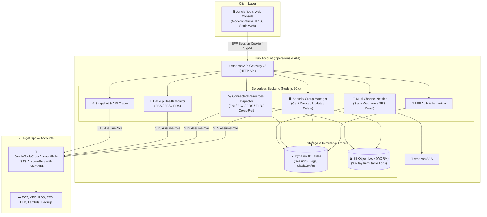

# Jungle Tools Console (AWS Multi-Account Operations & Backup Monitor)

<p align="center">
  
</p>

<p align="center">
  <strong>100% Self-Hosted Multi-Account Cloud Governance & Backup Monitoring Console (No External SaaS Required)</strong><br/>
  VPC Security Group Lifecycle & Connected Resources Inspector | EBS·EFS·RDS Backup Health | WORM S3 Object Lock Audit Trail | Slack·Email Intelligent Alerts
</p>

---

## 📖 Project Introduction

**Jungle Tools Console** is an enterprise-grade, **self-hosted cloud operations solution** deployed directly into your own AWS infrastructure.

Designed for organizations operating complex multi-account AWS environments (Hub-Spoke model), Jungle Tools eliminates the need to entrust sensitive AWS credentials or infrastructure metadata to third-party SaaS vendors. It gives you full, sovereign control over **VPC Security Group lifecycle management**, **real-time reverse inspection of connected AWS resources (EC2, RDS, ELBs, Lambda, etc.)**, **multi-service backup health monitoring (EBS, EFS, RDS)**, **orphaned snapshot & unused AMI cost optimization**, and **multi-channel automated alerting (Slack & Email)**.

### 💡 Why Jungle Tools?
- **100% In-Account Security**: All credentials, session tokens, and infrastructure configurations stay strictly within your AWS accounts. No external proxies or third-party servers.
- **Serverless Zero Idle Cost**: Built completely on serverless primitives (S3 static hosting, HTTP API Gateway v2, Lambda, and DynamoDB On-Demand). Zero idle cost when not actively processing.
- **Compliance-Grade WORM Audit Trail**: Every firewall creation, modification, and deletion event is immutably archived into Amazon S3 with **S3 Object Lock (GOVERNANCE mode, 30-day retention)**, satisfying stringent regulatory and enterprise compliance standards.
- **Seamless Multi-Account Operations**: Centrally manage and monitor a primary Hub account alongside 9 target Spoke accounts (10 accounts total) with one-click switching via secure AWS STS AssumeRole and ExternalId.

---

## 🌟 Key Features Summary

### 1. 🛡️ VPC Security Group Management & Deep Resource Inspection (SG Manage)
* **VPC-Segmented Security Group Explorer**:
  * Real-time multi-VPC security group discovery with horizontal tabs and multi-attribute search (Name, Group ID, Description, CIDR).
  * Seamless creation and safe deletion of Security Groups.
* **Visual Firewall Rule Editor (Inbound / Outbound)**:
  * Full GUI support for editing rules across all protocols (`All traffic`, `TCP`, `UDP`, `ICMP`), port ranges (`From` ~ `To`), and source/destination types (CIDR blocks, referenced SG IDs).
  * Strict client-side validation for port ranges (0~65535), CIDRs, and SG prefix formatting.
* **[NEW] Real-Time Connected Resources Deep Inspector**:
  * **Reverse Asset Discovery**: Automatically inspects and lists all live AWS resources bound to a security group, including **EC2 Instances, Application Load Balancers (ALB), Network Load Balancers (NLB), Gateway Load Balancers (GWLB), RDS Instances & Aurora Clusters, Lambda VPC Interfaces, VPC Endpoints (PrivateLink), NAT Gateways, and ENIs**.
  * **Cross-Security-Group Reference Detection**: Identifies whether other security groups permit ingress or egress traffic referencing this security group ID, preventing unexpected service outages prior to rule changes or deletions.
  * **Orphaned Security Group Detection**: Automatically tags unused security groups with an `Unused (Safe to Delete)` badge and safety alert card.
  * **Inspection Execution Logs & Trace**: Monospace terminal log streaming for API execution steps (`[INFO]`, `[WARN]`, `[ERROR]`) with actionable troubleshooting tips for IAM permission issues.

---

### 2. 💾 Multi-Service AWS Backup Monitoring (Backup Monitor)
* **EBS Volume & Snapshot Health**:
  * Real-time mapping of EBS volume statuses, latest snapshot completion timestamps, and operational health.
* **EFS File System Automatic Protection**:
  * Audits EFS file systems and verifies AWS Backup automatic policies (`ENABLED` / `DISABLED`).
* **RDS & Aurora Cluster Snapshot Verification**:
  * Inspects RDS database instances and Aurora clusters for automated/manual snapshot health and Point-In-Time Restore (`LatestRestorableTime`) metrics.
* **Standardized 3-Tier Health Classification**:
  * 🟢 **Healthy**: Successful backup completed within the last 7 days.
  * 🔴 **Failure / Warning**: Backup creation error, policy API failure, or last backup older than 8 days.
  * 🟡 **Unprotected**: No backup policy configured or zero snapshots exist.

---

### 3. 🔍 Orphaned Snapshot & Unused AMI Cost Optimization
* **Snapshot Tracer**:
  * Identifies orphaned EBS snapshots whose originating volumes have already been deleted, stopping unnecessary storage spend.
* **AMI Lifecycle Tracer**:
  * Discovers registered AMIs that are not referenced by any running EC2 instances or Launch Templates.
  * Dynamically calculates estimated monthly storage savings (`-$xx.xx/mo`) achievable by deregistering unused AMIs.

---

### 4. 🔒 WORM S3 Object Lock & DynamoDB Immutable Audit Trail
* **Legally Defensible Audit Logging**:
  * Every creation, rule modification, and deletion event is dual-written to DynamoDB (`SgAuditLogs`) and Amazon S3 with **S3 Object Lock (30-day retention)**.
* **WORM Compliance (`GOVERNANCE` Mode)**:
  * Guarantees that audit records cannot be overwritten, altered, or deleted during the retention window, even by root or administrator users.
* **JSON Diff Viewer**:
  * Inspect before/after rule diffs, operator identity (IAM Principal), timestamp (KST), and direct S3 Object URI in an interactive modal.

---

### 5. 🔔 Multi-Channel Intelligent Notification Center
* **Slack Incoming Webhooks**:
  * Manage multiple webhook endpoints with 4 distinct payload formats:
    1. `summary`: Executive one-line metric and health percentage.
    2. `report`: Comprehensive Markdown breakdown table across EBS, EFS, and RDS.
    3. `preview`: Top 5 critical Failure/Warning items requiring immediate action.
    4. `full`: Complete multi-account inventory report spanning all 10 registered accounts.
  * Automated EventBridge cron scheduling and instant test dispatch.
* **Slack Channel Email (AWS SES)**:
  * Sends beautiful, formatted HTML table reports directly to Slack Channel Email addresses (`channel@workspace.slack.com`).
* **Corporate & AWS SES SMTP Integration**:
  * Configurable SMTP host, port (587 STARTTLS, 465 SSL, 25), authentication, and real-time 250 OK handshake diagnostics.
* **Recipients Directory Management**:
  * Maintain team/department email distribution lists with active/pause toggles and batch test dispatch simulation.

---

### 6. 🏢 One-Click Multi-Account Context Switching
* **10 AWS Accounts Out-of-the-Box**:
  * Hub operations account + 9 target Spoke accounts (`dev`, `test`, `prd`, `cicd`, `logging`, `bi`, etc.).
* **BFF (Backend-for-Frontend) Session Security**:
  * STS authentication issuing an 8-hour `HttpOnly; Secure; SameSite=None` encrypted session cookie.
  * Dynamic cross-account STS AssumeRole injection with `JungleToolsCrossAccountRole` and `ExternalId`.

---

### 🖥️ Live Console Screen Previews

| Console View | Description | Live Browser Capture |
| :--- | :--- | :---: |
| **Home Dashboard** | Unified multi-account infrastructure & backup KPIs | [View Dashboard](images/screen_home.jpg) |
| **SG Manage Operator** | VPC-grouped security group list & overview | [View SG Manage](images/screen_sg_dashboard.jpg) |
| **Firewall Rules Editor** | Inbound/outbound real-time rule editor and applicator | [View Rules Editor](images/screen_sg_detail.jpg) |
| **Connected Resources** | Real-time ENI reverse-inspection (EC2, ELB, RDS) & cross-SG rules | [View Connected Resources](images/screen_sg_resources.jpg) |
| **Backup Monitor** | Real-time health tracking for EBS, EFS, and RDS backups | [View Backup Monitor](images/screen_backup.jpg) |
| **Snapshot & AMI Tracers** | Orphaned snapshot & unused AMI identification with cost savings | [Snapshot Tracer](images/screen_backup_snapshot_tracer.jpg) / [AMI Tracer](images/screen_backup_ami_tracer.jpg) |
| **WORM Audit Trail** | S3 Object Lock 30-day immutable compliance logs | [View Audit Trail](images/screen_sg_logs.jpg) |
| **Multi-Channel Alerts** | Slack Multi-Webhooks and Email SMTP / Recipients Directory | [Slack Webhook](images/screen_slack_webhook.jpg) / [Email Recipients](images/screen_email.jpg) |

---

## 🏗️ System Architecture



---

## 📚 Technical Documentation Index

| Document | Description | Link |
| :--- | :--- | :---: |
| **Service Introduction** | Value proposition, self-hosted benefits, and ROI | [SERVICE_INTRODUCTION.md](SERVICE_INTRODUCTION.md) |
| **User Manual** | Complete UI guide, **connected resources usage**, and FAQ | [USER_MANUAL.md](USER_MANUAL.md) |
| **Feature Map** | Mindmap, menu hierarchy, and backend API mapping table | [FEATURE_MAP.md](FEATURE_MAP.md) |
| **Installation Guide** | AWS SAM CLI build, Spoke IAM deployment, and config | [INSTALL.md](INSTALL.md) |
| **Test Scenarios** | JSDOM frontend (8), unit tests (21), and cloud E2E (16) | [TEST_SCENARIOS.md](TEST_SCENARIOS.md) |
| **Korean README** | Official Korean README and documentation overview | [../README.md](../README.md) |

---

## 🚀 Quick Start & Deployment

### Prerequisites
- **Node.js**: v20.x or higher
- **AWS CLI**: v2.x or higher configured with administrative credentials
- **AWS SAM CLI**: v1.100.0 or higher

### 1) Deploy Backend & Hub Infrastructure
```bash
# 1. Install backend dependencies
npm install --prefix backend

# 2. Build and deploy via AWS SAM
sam build
sam deploy --guided
```

### 2) Deploy Spoke Account Roles (9 Accounts)
```bash
# Deploy to a single Spoke account
aws cloudformation deploy \
  --template-file spoke-account-template.yaml \
  --stack-name JungleToolsCrossAccountRole \
  --parameter-overrides HubAccountId=<HUB_ACCOUNT_ID> \
  --capabilities CAPABILITY_NAMED_IAM

# Or run the batch automation script for all accounts
./scripts/setup-all-spokes.sh
```

### 3) Deploy Frontend Static Assets
```bash
# Sync frontend assets to S3
aws s3 sync frontend/ s3://<FRONTEND_BUCKET_NAME>/ --delete
```

### 4) Run Automated Tests
```bash
# Run unit tests and JSDOM frontend tests
npm test --prefix backend

# Run live cloud E2E integration tests
./scripts/test-all.sh
```

---

## 📄 License

This project is licensed under the Apache License 2.0 - see the [LICENSE](../LICENSE) file for details.
