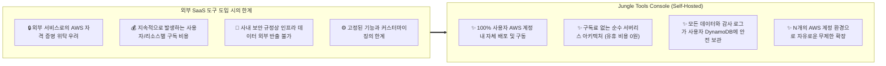
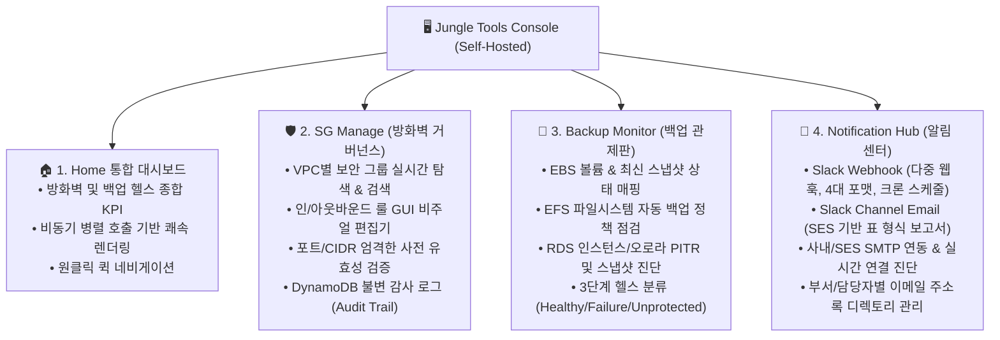

# Jungle Tools Console 서비스 소개서 (Service Overview)

> **"사용자 자체 AWS 환경에 직접 배포하여 소유하는 셀프 호스티드(Self-Hosted) 방화벽 거버넌스 & 백업 관제 솔루션"**  
> **Jungle Tools Console**은 사용자의 AWS 인프라에 직접 설치하여 운영하는 클라우드 네이티브 서버리스 솔루션입니다. 외부 SaaS 서비스에 자격 증명이나 데이터를 위탁할 필요 없이, **사용자 소유의 AWS 환경 내에서 VPC 보안 그룹(Security Group) 통합 제어**, **데이터 백업(EBS, EFS, RDS) 실시간 헬스케어**, 그리고 **다채널 알림(Slack & Email) 자동화**를 완벽하게 통제할 수 있습니다.

---

## 1. 제품 포지셔닝 및 개발 배경 (Product Positioning)

많은 기업들이 AWS 인프라 운영 과정에서 외부 서드파티 SaaS 도구 도입을 검토하지만, 다음과 같은 현실적인 제약과 보안 문제에 직면합니다:



Jungle Tools Console은 **"인프라의 통제권과 데이터는 온전히 인프라 소유자에게 있어야 한다"**는 원칙 아래 개발된 **설치형(Self-Hosted) 클라우드 오퍼레이션 솔루션**입니다.

---

## 2. 핵심 차별점 및 가치 (Key Differentiators)

| 핵심 가치 | 상세 설명 |
| :--- | :--- |
| **100% In-Account Security**<br/>(완전한 데이터 및 권한 통제) | • 외부 서버를 일절 경유하지 않으며, 사용자의 브라우저에서 AWS SigV4로 직접 서명하여 자체 API Gateway로 통신합니다.<br/>• 모든 백업 상태 정보와 방화벽 변경 이력은 사용자 소유의 DynamoDB에만 저장됩니다. |
| **Flexible Multi-Account Scaling**<br/>(유연한 멀티 계정 확장성) | • 단일 계정은 물론, 조직 내 N개의 타겟 계정을 원하는 만큼 자유롭게 등록하여 모니터링할 수 있습니다.<br/>• 표준 IAM Cross-Account Role(STS AssumeRole) 기반으로 계정 간 안전한 최소 권한 통신을 수행합니다. |
| **Serverless Cost-Efficiency**<br/>(서버리스 기반의 압도적 비용 절감) | • 상시 가동되는 EC2나 컨테이너가 전혀 없으며, S3 정적 호스팅, API Gateway, Lambda, DynamoDB On-Demand로 구성되어 운영 유지비가 거의 발생하지 않습니다. |
| **One-Click Native Deployment**<br/>(간편한 코드 기반 배포) | • AWS SAM(Serverless Application Model) 템플릿 기반으로 구축되어, 간단한 CLI 명령어 몇 줄로 전체 백엔드와 프론트엔드가 즉시 프로비저닝됩니다. |

---

## 3. 4대 주요 기능 (Core Capabilities)



### 1) 🏠 Home (통합 오퍼레이션 대시보드)
* **전체 인프라 건강도 단일 뷰**: 활성 VPC 현황, 전체 보안 그룹 수, 인바운드 룰 수 및 백업 헬스 지표(Healthy / Failure / Unprotected)를 첫 화면에서 직관적으로 파악.
* **비동기 병렬 동기화**: `Promise.allSettled` 백그라운드 호출을 통해 대규모 인프라 리소스도 끊김 없이 쾌속 렌더링.
* **빠른 탐색 지원**: 알림 설정, 보안 감사 로그, 상세 대시보드로 원클릭 분기 이동.

### 2) 🛡️ SG Manage (VPC 보안 그룹 통합 제어)
* **VPC 탭 뷰 & 실시간 검색**: VPC별 수평 탭과 다차원 실시간 검색 필터(이름, ID, 설명, 대역)를 통해 방화벽 규칙을 신속하게 탐색.
* **비주얼 룰 편집기**: 프로토콜(All, TCP, UDP, ICMP), 포트 범위, 소스/목적지(CIDR, 보안 그룹 참조)를 GUI 화면에서 손쉽게 추가, 수정, 삭제.
* **클라이언트 사전 유효성 검증**: 포트 번호 범위(0~65535), 대소 관계, `sg-` 식별자 검증으로 잘못된 룰 배포를 사전에 원천 차단.
* **불변 변경 감사 추적 (Audit Trail)**: 보안 그룹 생성, 삭제, 인/아웃바운드 룰 변경 내역이 DynamoDB에 타임스탬프와 함께 불변 기록되어 내부 감사 및 컴플라이언스 완벽 대응.

### 3) 💾 Backup Monitor (멀티 서비스 백업 관제)
* **EBS 볼륨 & 스냅샷**: 볼륨 크기/유형 및 최신 스냅샷 완료 상태를 실시간 진단.
* **EFS 파일 시스템**: 파일시스템 상태 및 AWS Backup 정책 활성화(`ENABLED` / `DISABLED`) 여부 점검.
* **RDS DB & Aurora 클러스터**: DB 인스턴스 보존 기간, Aurora 최신 복원 시점(`LatestRestorableTime`), 수동/자동 스냅샷을 통합 진단.
* **표준화된 3단계 헬스 분류**:
  * 🟢 **Healthy (정상)**: 최근 7일 이내 성공적인 백업 완료
  * 🔴 **Failure (경고/장애)**: 백업 생성 실패 또는 8일 이상 경과된 장기 미백업 리소스
  * 🟡 **Unprotected (미보호)**: 백업 정책이나 스냅샷이 전혀 존재하지 않는 무방비 리소스

### 4) 🔔 Notification Center (스마트 다채널 알림 허브)
* **Slack Webhook 다중 연동**:
  * 팀별, 채널별 N개의 슬랙 웹훅 등록 및 활성/일시정지 관리.
  * **4가지 맞춤형 포맷**: `summary` (한 줄 요약), `report` (서비스별 마크다운 상세 보고서), `preview` (장애 상위 5건 집중 표시), `full` (전체 등록 계정 종합 리포트).
  * KST 기준 정기 EventBridge 크론 스케줄링 및 단일/전체 즉시 테스트 발송.
* **Slack Channel Email**: 슬랙 채널 고유 이메일로 Amazon SES 기반 표 형식(HTML) 리포트 자동 전송.
* **사내 SMTP 연동 & 수신자 주소록**:
  * 사내 메일 서버 또는 Amazon SES SMTP(STARTTLS/SSL) 연결 정보 설정 및 실시간 핸드셰이크 테스트.
  * 담당자 및 부서별 이메일 주소록 관리, 개별 활성/비활성 토글 및 일괄 테스트 발송 지원.

---

## 4. 시스템 아키텍처 (Self-Hosted Architecture)

사용자의 AWS 계정에 배포된 솔루션 컴포넌트는 다음과 같이 완벽한 격리 환경에서 구동됩니다:

```mermaid
flowchart TB
    subgraph Client ["Client Layer (운영자 웹 브라우저)"]
        Browser["🖥️ Jungle Tools Web Console<br/>(AWS IAM SigV4 클라이언트 직접 서명)"]
    end

    subgraph UserHubAccount ["🏢 중앙 관리 계정 (사용자 소유 AWS 계정)"]
        S3["🪣 Amazon S3<br/>(정적 웹사이트 호스팅)"]
        APIGW["⚡ API Gateway v2<br/>(IAM SigV4 Authorizer)"]
        
        subgraph Lambdas ["AWS Lambda (Node.js 20.x 서버리스 백엔드)"]
            SG_Func["🔒 Security Group 제어"]
            Backup_Func["💾 Backup 헬스 점검"]
            Noti_Func["📩 Slack/Email 알림 발송"]
            Audit_Func["📜 감사 로그 조회"]
        end

        subgraph Storage ["자체 데이터 스토리지"]
            AuditDB[("📊 DynamoDB: SgAuditLogs")]
            ConfigDB[("⚙️ DynamoDB: SlackConfig")]
        end

        EventBridge["⏰ EventBridge Cron<br/>(정기 알림 스케줄러)"]
        SES["📧 Amazon SES<br/>(이메일 발송 엔진)"]
    end

    subgraph UserTargetAccounts ["🎯 관리 대상 계정들 (N개의 사용자 AWS 계정)"]
        Role["🔑 Cross-Account IAM Role<br/>(STS AssumeRole 최소 권한)"]
        Resources["🛡️ VPC / Security Groups<br/>💾 EBS / EFS / RDS"]
    end

    subgraph NotificationEndpoints ["알림 수신 채널"]
        Slack["💬 Slack 채널 (Webhook / Email)"]
        EmailRecipients["👥 담당자 이메일 수신함"]
    end

    Browser -->|HTTPS 에셋 로드| S3
    Browser -->|SigV4 서명 API 호출| APIGW
    APIGW --> Lambdas
    Lambdas --> Storage
    EventBridge --> Noti_Func
    Noti_Func --> SES

    Lambdas -.->|STS AssumeRole (필요 시)| Role
    Role --> Resources

    Noti_Func --> Slack
    SES --> Slack & EmailRecipients
```

---

## 5. 도입 효과 (Business & Operational Value)

1. **외부 유출 걱정 없는 완벽한 보안 통제**:
   * 인프라 자격 증명이나 구성 정보가 외부 클라우드나 SaaS 업체로 전달되지 않아 엔터프라이즈 보안 감사 및 컴플라이언스를 100% 충족합니다.
2. **반복되는 인프라 점검 자동화**:
   * 콘솔을 매번 뒤적거릴 필요 없이, 백업이 누락된 무방비 리소스(`Unprotected`)와 실패 리소스(`Failure`)를 매일 아침 자동으로 탐지하여 알림을 전달합니다.
3. **방화벽 휴먼 에러 방지 및 변경 이력 추적**:
   * GUI 기반의 입력 검증으로 포트 설정 오류를 방지하고, 모든 수정 내역을 DynamoDB에 보존하여 투명한 변경 이력 거버넌스를 수립합니다.
4. **유휴 비용 없는 초경량 TCO**:
   * 사용한 만큼만 과금되는 서버리스 구조로, 별도의 서버 호스팅 비용이나 라이선스 구독료 없이 인프라 운영 솔루션을 영구 소유할 수 있습니다.
