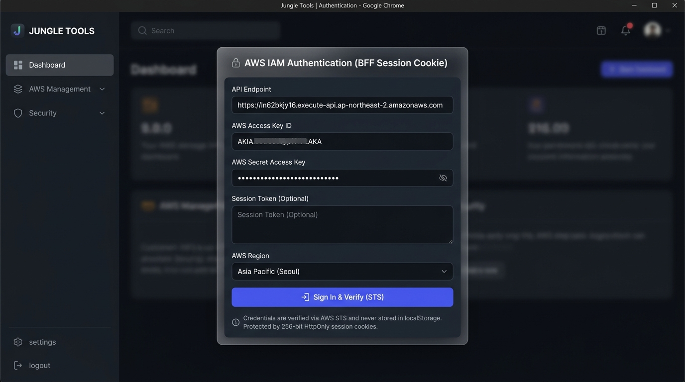
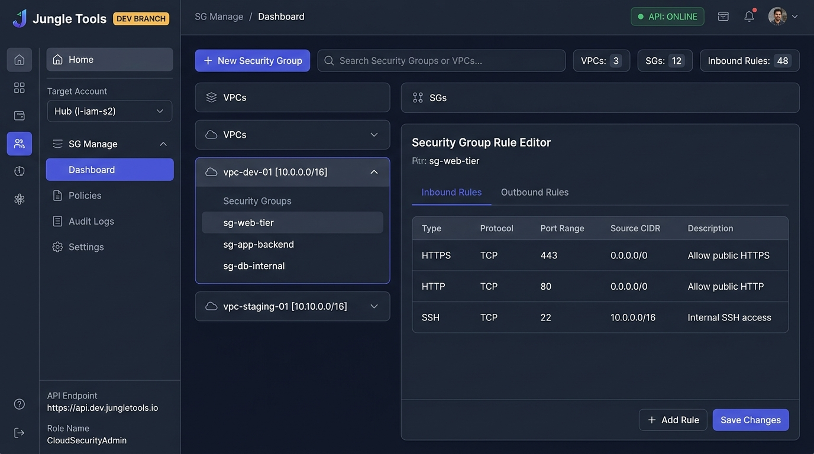
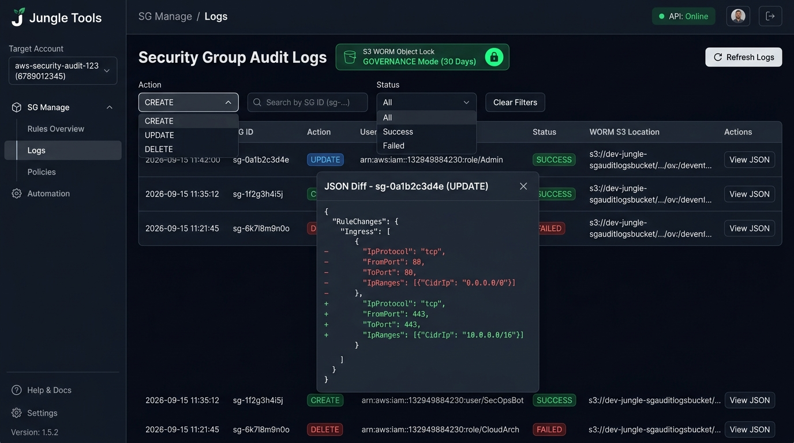
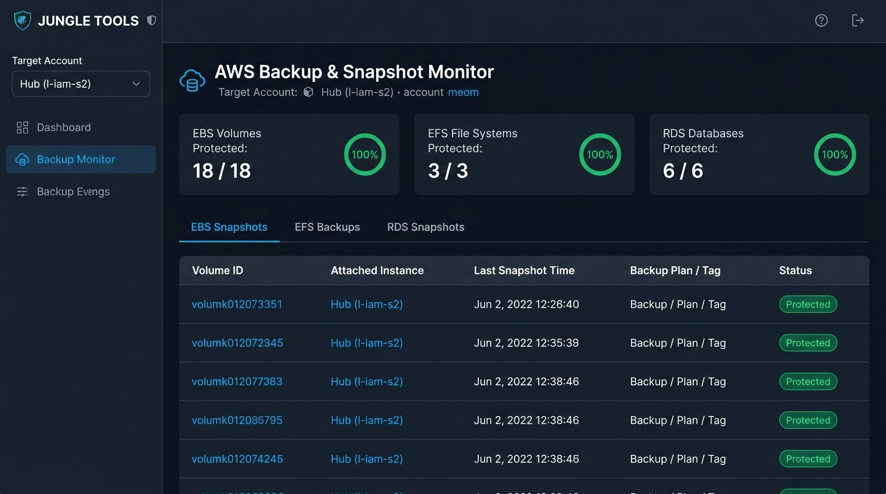
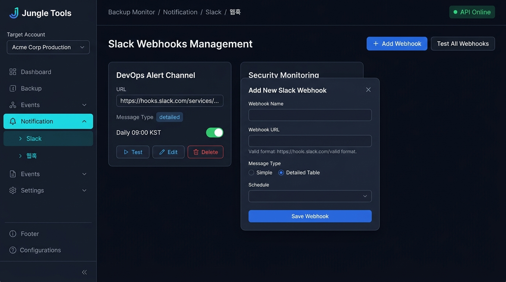
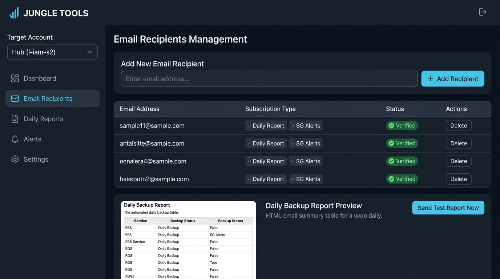

# Jungle Tools 종합 사용자 매뉴얼 (User Manual) & 기능 사용 가이드

Jungle Tools는 멀티 계정 AWS 클라우드 환경에서 **VPC 보안 그룹(Security Group) 라이프사이클 관리**, **WORM S3 Object Lock 규정 준수 감사 로깅**, **멀티 서비스(EBS, EFS, RDS) 백업 통합 관제**, 그리고 **Slack/Email 지능형 알림 자동화**를 제공하는 엔터프라이즈급 클라우드 관리 콘솔입니다.

---

## 목차 (Table of Contents)

1. [시스템 아키텍처 및 BFF 세션 보안](#1-시스템-아키텍처-및-bff-세션-보안)
2. [공통 레이아웃 및 글로벌 UI 요소](#2-공통-레이아웃-및-글로벌-ui-요소)
   - [2.1 좌측 사이드바 (Left Sidebar)](#21-좌측-사이드바-left-sidebar)
   - [2.2 대상 AWS 계정 전환 (Target Account Selector)](#22-대상-aws-계정-전환-target-account-selector)
   - [2.3 상단 헤더 바 (Top Header Bar)](#23-상단-헤더-바-top-header-bar)
   - [2.4 로그인 및 세션 관리 (Auth Modal)](#24-로그인-및-세션-관리-auth-modal)
3. [메뉴별 화면 구성 및 상세 사용법 (Step-by-Step)](#3-메뉴별-화면-구성-및-상세-사용법-step-by-step)
   - [3.1 홈 대시보드 (Home)](#31-홈-대시보드-home)
   - [3.2 보안 그룹 및 방화벽 관리 (SG Manage > Dashboard)](#32-보안-그룹-및-방화벽-관리-sg-manage--dashboard)
   - [3.3 보안 감사 로그 및 WORM 스토리지 (SG Manage > Logs)](#33-보안-감사-로그-및-worm-스토리지-sg-manage--logs)
   - [3.4 멀티 서비스 백업 관제 (Backup Monitor > Dashboard)](#34-멀티-서비스-백업-관제-backup-monitor--dashboard)
   - [3.5 Slack 멀티 웹훅 알림 설정 (Notification > Slack > 웹훅)](#35-slack-멀티-웹훅-알림-설정-notification--slack--웹훅)
   - [3.6 이메일 주소 등록 및 일일 백업 리포트 (Notification > Email)](#36-이메일-주소-등록-및-일일-백업-리포트-notification--email)
4. [운영 FAQ 및 트러블슈팅](#4-운영-faq-및-트러블슈팅)

---

## 1. 시스템 아키텍처 및 BFF 세션 보안

Jungle Tools는 안전하고 확장성 높은 서버리스 및 **BFF(Backend-for-Frontend) 패턴**으로 구축되었습니다.

```
[사용자 브라우저]
  │  ▲
  │  │ (1) STS GetCallerIdentity 인증 및 8시간 세션 쿠키 발급
  │  │ (2) HttpOnly, Secure, SameSite=None 세션 쿠키 전달
  ▼  │ (3) credentials: 'include'를 통한 모든 API 호출
[Amazon API Gateway v2 (HTTP API)]
  │
  ├──► [Lambda Request Authorizer (AuthAuthorizerFunction)]
  │      └─► DynamoDB (UserSessionsTable - 256비트 암호화 세션 & TTL 만료)
  │
  ├──► [BFF 인증 핸들러 (Login, Logout, Me)]
  │      └─► AWS STS 검증
  │
  ├──► [비즈니스 로직 Lambdas]
  │      ├─► 허브/스포크 계정 AssumeRole (JungleToolsCrossAccountRole)
  │      ├─► EC2 보안 그룹 및 인바운드/아웃바운드 방화벽 제어
  │      ├─► EBS / EFS / RDS 백업 현황 실시간 스캔
  │      └─► Slack Incoming Webhook / SES Email 자동 발송
  │
  └──► [데이터 저장소]
         ├─► DynamoDB: 실시간 세션, 감사 로그, 알림 설정
         └─► S3 Bucket (Object Lock WORM): 30일간 변조 불가 감사 로그 보존
```

---

## 2. 공통 레이아웃 및 글로벌 UI 요소

### 2.1 좌측 사이드바 (Left Sidebar)
- **브랜드 로고 (`#app-logo-title`)**: Jungle Tools 로고 및 현재 Git 브랜치(`develop`) 표시
- **Home 메뉴 (`#nav-home`)**: 최상단 인프라 통합 대시보드로 즉시 이동
- **Target Account 셀렉터 (`#target-account-select`)**: 관리 대상 AWS 계정 즉시 전환
- **SG Manage 메뉴군**: 방화벽 관리 대시보드 및 감사 로그
- **Backup Monitor 메뉴군**: 백업 관제 대시보드 및 Slack/Email 알림 설정
- **사이드바 푸터**: 현재 연결된 백엔드 `API Endpoint` 및 위임 `Role Name` (`JungleToolsCrossAccountRole`) 표시

### 2.2 대상 AWS 계정 전환 (Target Account Selector)


**[사용법 Step-by-Step]**
1. **1단계**: 좌측 사이드바 상단의 `Target Account` 드롭다운 클릭
2. **2단계**: 관리하고자 하는 AWS 계정 선택 (`Hub (l-iam-s2)`, `l-ellotte-dev`, `l-b2-dev`, `l-cicd-s2`)
3. **3단계**: 시스템이 STS AssumeRole을 통해 해당 계정의 보안 그룹 및 백업 리소스를 즉시 불러옴

### 2.3 상단 헤더 바 (Top Header Bar)
- **Breadcrumb (`#breadcrumb-active`)**: 현재 화면의 위치 경로 표시 (예: `SG Manage / Dashboard`)
- **API Status Badge (`#api-status`)**: 백엔드 연결 상태 (`Online` 녹색 / `Expired` 황색 / `Disconnected` 적색)
- **User Profile Display (`#header-user-display`)**: 현재 로그인된 관리자 식별자 표시
- **로그아웃 버튼 (`#btn-logout`)**: 클릭 시 BFF 세션을 안전하게 종료하고 로그인 창으로 전환

### 2.4 로그인 및 세션 관리 (Auth Modal)


**[사용법 Step-by-Step]**
1. **1단계**: Jungle Tools 웹 콘솔 접속 시 미인가 상태이면 `#modal-login` 로그인 창이 중앙에 표시됩니다.
2. **2단계**: 관리자 ID와 비밀번호를 입력합니다.
3. **3단계**: `Sign In` 버튼을 클릭합니다. 인증 성공 시 8시간 유효한 `HttpOnly` 세션 쿠키가 발급되며 `Online` 상태로 진입합니다.
4. **4단계**: 작업 완료 후 상단 `Disconnect` 버튼을 눌러 안전하게 로그아웃합니다.

---

## 3. 메뉴별 화면 구성 및 상세 사용법 (Step-by-Step)

### 3.1 홈 대시보드 (Home)


계정 내 인프라 보안 그룹 및 백업 현황을 한눈에 파악하는 통합 대시보드입니다.

#### 주요 UI 요소
- **`#btn-refresh-home`**: 전체 VPC 보안 그룹 및 백업 리소스 실시간 재집계
- **SG Manage 요약 카드**: Active VPCs, Total Security Groups, Inbound Rules 지표
- **Backup Monitor 요약 카드**: Total Resources, Healthy (<=7d), Failure/Warning, Unprotected 지표
- **Quick Action 바로가기 배너**: 보안 그룹 관리, 백업 관제, Slack 웹훅, Email 주소 등록 바로가기

#### [사용법 Step-by-Step]
1. **1단계**: 좌측 사이드바에서 `Home` 메뉴를 클릭합니다.
2. **2단계**: 상단 요약 카드를 통해 현재 활성 VPC 개수와 총 보안 그룹 및 규칙 개수를 확인합니다.
3. **3단계**: 백업 관제 카드에서 최근 7일 내 정상 보호된 백업(Healthy) 비율을 점검합니다.
4. **4단계**: 세부 설정이나 긴급 조치가 필요한 경우 바로가기 버튼을 눌러 해당 관리 화면으로 즉시 이동합니다.

---

### 3.2 보안 그룹 및 방화벽 관리 (SG Manage > Dashboard)


VPC별 아코디언 목록을 확인하고, 신규 보안 그룹 생성 및 인바운드/아웃바운드 방화벽 규칙을 웹에서 직관적으로 편집합니다.

#### 주요 UI 요소
- **`#btn-open-create-sg`**: 신규 보안 그룹 생성 모달 (`#modal-create-sg`) 호출
- **`#sidebar-sg-search`**: 보안 그룹 이름 또는 ID 실시간 검색창
- **`#vpc-list`**: VPC별 보안 그룹 아코디언 트리
- **`#tab-inbound` / `#tab-outbound`**: 인바운드 / 아웃바운드 규칙 탭 전환
- **`#btn-add-inbound-rule`**: 새 방화벽 규칙 행 추가 버튼
- **`#btn-save-rules`**: 편집된 규칙을 AWS EC2에 즉시 일괄 적용하는 저장 버튼
- **`#btn-delete-sg`**: 선택된 보안 그룹 안전 삭제 버튼

#### [사용법 Step-by-Step]
1. **신규 보안 그룹 생성**:
   - 1. 우측 상단 `+ New Security Group` 버튼을 클릭합니다.
   - 2. 모달 창에서 대상 **VPC**를 선택하고, **Group Name** 및 **Description**을 입력합니다.
   - 3. `Create Security Group` 버튼을 클릭하여 생성합니다.
2. **방화벽 인바운드/아웃바운드 규칙 편집**:
   - 1. 좌측 VPC 트리에서 편집할 보안 그룹을 선택합니다.
   - 2. `Inbound Rules` 또는 `Outbound Rules` 탭을 클릭합니다.
   - 3. `+ Add Rule` 버튼을 눌러 Type(HTTP, HTTPS, SSH, Custom TCP 등), Port Range, Source CIDR(예: `10.0.0.0/16`), Description을 입력합니다.
   - 4. 우측 하단 `Save Changes` 버튼을 클릭하여 즉시 AWS EC2 방화벽에 적용합니다.

---

### 3.3 보안 감사 로그 및 WORM 스토리지 (SG Manage > Logs)


모든 보안 그룹 변경 이력(`CREATE`, `UPDATE`, `DELETE`)을 조회하며, 규정 준수를 위한 **S3 Object Lock (30일 보존)** 스토리지 위치를 확인합니다.

#### 주요 UI 요소
- **`#log-s3-bucket-name`**: 감사 원본 파일이 암호화 보관되는 WORM S3 버킷 명칭
- **Object Lock Compliance 뱃지**: `GOVERNANCE Mode (30 Days)` 무결성 보증 뱃지
- **`#btn-refresh-logs`**: 감사 로그 실시간 새로고침 버튼
- **`#modal-log-detail`**: 변경 전/후 JSON Diff 및 S3 Object URI 상세 열람 모달

#### [사용법 Step-by-Step]
1. **1단계**: 좌측 사이드바에서 `SG Logs` 메뉴를 클릭합니다.
2. **2단계**: 감사 로그 테이블에서 작업 일시, 작업자(IAM Principal), 작업 유형, 대상 SG ID를 확인합니다.
3. **3단계**: 특정 로그 행의 `View Details` 버튼을 클릭하여 변경 전/후 방화벽 규칙 Diff와 S3 원본 위치(`s3Location`)를 열람합니다.

---

### 3.4 멀티 서비스 백업 관제 (Backup Monitor > Dashboard)


EBS 볼륨, EFS 파일 시스템, RDS 데이터베이스의 일일 백업 및 자동 보호 정책 준수 여부를 통합 감시합니다.

#### 주요 UI 요소
- **백업 요약 지표 카드**: EBS Volumes, EFS File Systems, RDS Databases의 보호 현황 및 100% 달성 뱃지
- **`#tab-backup-ebs`**: EBS 볼륨별 연결 인스턴스, 최근 스냅샷 시간, 보호 상태 테이블
- **`#tab-backup-efs`**: EFS 파일 시스템별 자동 백업 정책 및 복구 시점 테이블
- **`#tab-backup-rds`**: RDS 데이터베이스별 스냅샷 생성 현황 및 백업 주기 점검 테이블

#### [사용법 Step-by-Step]
1. **1단계**: 좌측 사이드바에서 `Backup Monitor` 메뉴를 클릭합니다.
2. **2단계**: 상단 요약 카드에서 EBS, EFS, RDS 리소스의 보호율을 점검합니다.
3. **3단계**: 하단 탭을 전환하며 각 스토리지 리소스의 최신 스냅샷 생성 일시와 상태(`Protected` / `Warning`)를 확인합니다.
4. **4단계**: 미보호 리소스가 발견되면 AWS Backup 콘솔 또는 리소스 태그를 통해 백업 플랜을 즉시 적용합니다.

---

### 3.5 Slack 멀티 웹훅 알림 설정 (Notification > Slack > 웹훅)


여러 운영 Slack 채널로 일일 백업 리포트 및 보안 변경 알림을 자동 전송하기 위해 다중 Webhook을 등록하고 관리합니다.

#### 주요 UI 요소
- **`#btn-open-add-webhook`**: 신규 Slack 웹훅 추가 모달 호출
- **`#btn-test-all-webhooks`**: 등록된 모든 채널로 일괄 테스트 메시지 발송
- **웹훅 목록 테이블**: Webhook Name, URL, Message Type(`detailed` / `simple`), Schedule, Status
- **개별 `Test` 버튼**: 해당 채널로 단독 테스트 알림 즉시 발송

#### [사용법 Step-by-Step]
1. **1단계**: 좌측 메뉴에서 `Notification > Slack > 웹훅`으로 이동합니다.
2. **2단계**: `+ Add Webhook` 버튼을 클릭하여 웹훅 이름, Slack Incoming Webhook URL, 메시지 포맷을 입력하고 저장합니다.
3. **3단계**: 등록된 웹훅의 `Test` 버튼을 눌러 슬랙 채널로 메시지가 정상 도달하는지 확인합니다.
4. **4단계**: `Test All Webhooks` 버튼을 눌러 전체 운영 채널의 통신 상태를 일괄 검증합니다.

---

### 3.6 이메일 주소 등록 및 일일 백업 리포트 (Notification > Email)


정기 일일 백업 요약 보고서를 수신할 담당자 이메일을 등록하고, 완성된 HTML 이메일 보고서를 미리보기 및 즉시 발송합니다.

#### 주요 UI 요소
- **`#email-recipients-input`**: 다중 이메일 주소 입력란 (쉼표, 세미콜론, 줄바꿈 구분 지원)
- **`#btn-save-recipients`**: 수신자 목록 저장 버튼
- **`#btn-preview-email-report`**: 전체 AWS 계정 백업 현황이 집계된 실제 HTML 리포트 미리보기 버튼
- **`#btn-send-email-now`**: 등록된 모든 수신자에게 백업 리포트 즉시 발송 버튼

#### [사용법 Step-by-Step]
1. **1단계**: 좌측 메뉴에서 `Notification > Email > 주소 등록`으로 이동합니다.
2. **2단계**: 입력란에 수신할 담당자 이메일 주소들을 입력하고 `Save Recipients`를 클릭합니다.
3. **3단계**: 하단 `Daily Backup Report Preview` 영역의 `Preview Report` 버튼을 눌러 발송될 메일 레이아웃을 확인합니다.
4. **4단계**: `Send Test Report Now` (또는 `Send Email Now`) 버튼을 클릭하여 즉시 보고서를 일괄 발송합니다.

---

## 4. 운영 FAQ 및 트러블슈팅

### Q1. 로그인 시 "Failed to fetch" 오류가 발생합니다.
> **원인 및 조치**: 브라우저에 이전 정적 캐시가 남아있을 수 있습니다. `Ctrl + F5` (또는 Mac의 경우 `Cmd + Shift + R`)를 눌러 브라우저 캐시를 강력 새로고침한 뒤 다시 접속하세요.

### Q2. 8시간 후 작업 시 "세션이 만료되었습니다" 알림이 나타납니다.
> **원인 및 조치**: BFF 보안 정책상 발급된 HttpOnly 세션은 8시간 TTL을 가집니다. 상단 헤더의 `Re-login` 버튼을 클릭하여 자격 증명을 입력하면 작업 상태를 유지한 채 세션이 갱신됩니다.

### Q3. 특정 스포크 계정(예: l-ellotte-dev) 선택 시 리소스 조회가 실패합니다.
> **원인 및 조치**: 대상 스포크 계정에 `JungleToolsCrossAccountRole` IAM 역할이 생성되어 있지 않거나 신뢰 관계에 허브 계정 ID가 누락된 경우입니다. 스포크 계정에서 CloudFormation 템플릿(`spoke-account-template.yaml`)을 배포하면 즉시 해결됩니다.
